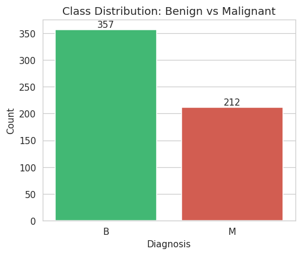
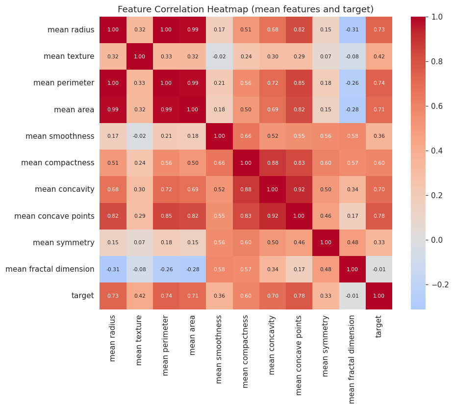
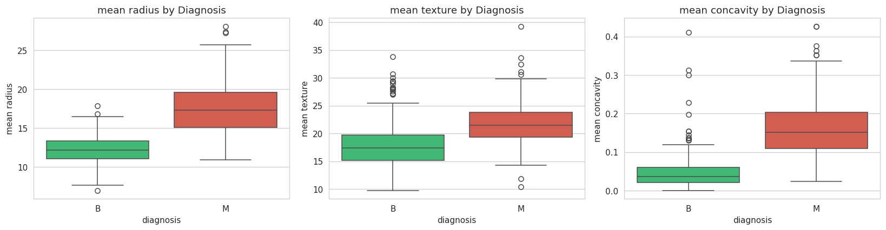
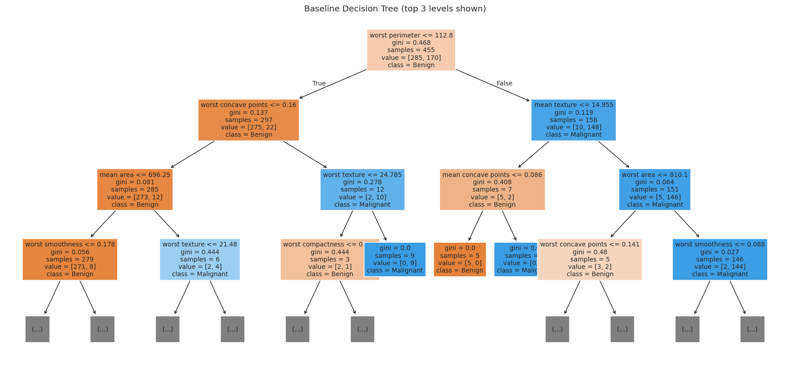
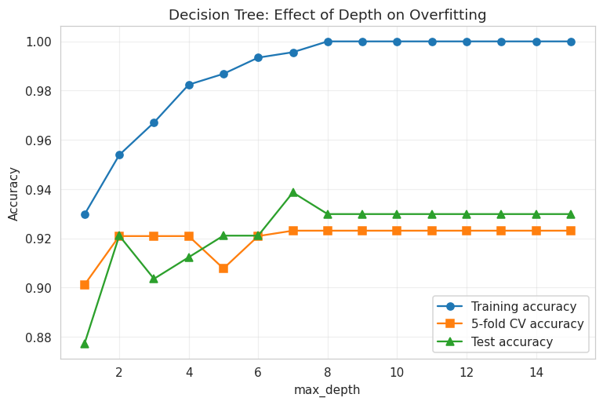
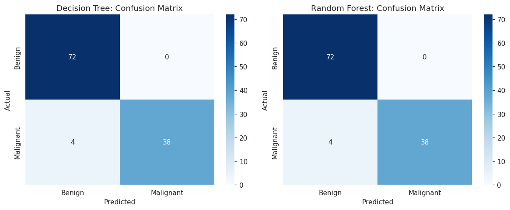
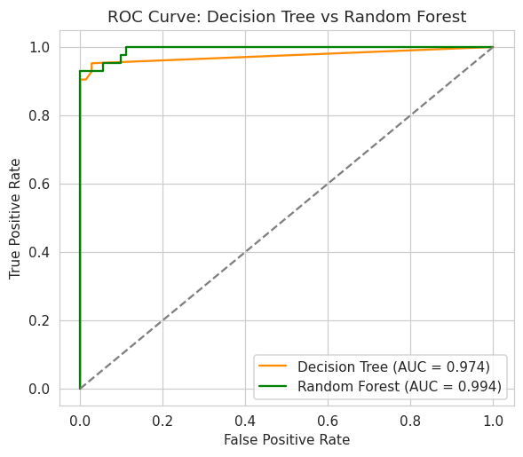
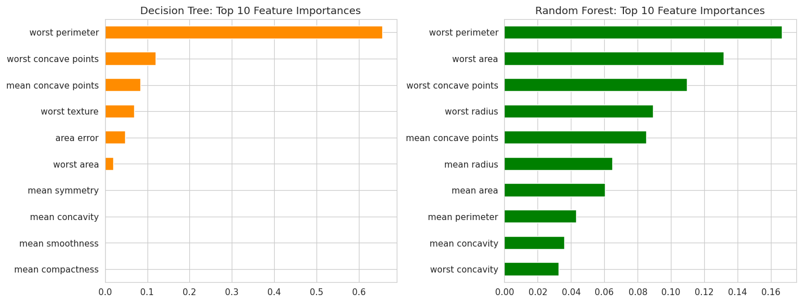
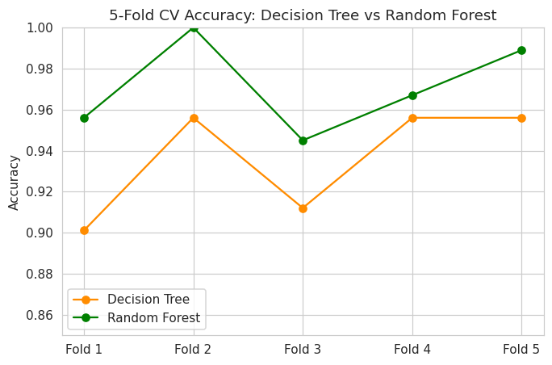

#+OPTIONS: title:nil toc:nil num:nil ^:nil
#+LATEX_HEADER: \usepackage[a4paper,margin=1in]{geometry}
#+LATEX_HEADER: \usepackage{graphicx}
#+LATEX_HEADER: \usepackage{booktabs}
#+LATEX_HEADER: \usepackage{array}
#+LATEX_HEADER: \usepackage{amsmath,amssymb}
#+LATEX_HEADER: \usepackage{float}
#+LATEX_HEADER: \usepackage{xurl}
#+LATEX_HEADER: \usepackage{xcolor}
#+LATEX_HEADER: \usepackage{listings}
#+LATEX_HEADER: \usepackage{fvextra}
#+LATEX_HEADER: \usepackage{enumitem}
#+LATEX_HEADER: \usepackage{fancyhdr}
#+LATEX_HEADER: \usepackage{longtable}
#+LATEX_HEADER: \newcolumntype{L}[1]{>{\raggedright\arraybackslash}p{#1}}
#+LATEX_HEADER: \emergencystretch=3em
#+LATEX_HEADER: \setlength{\headheight}{14.5pt}
#+LATEX_HEADER: \hypersetup{colorlinks=true,linkcolor=blue,urlcolor=blue,hypertexnames=false}
#+LATEX_HEADER: \DefineVerbatimEnvironment{verbatim}{Verbatim}{breaklines=true,breakanywhere=true,fontsize=\small}
#+LATEX_HEADER: \pagestyle{fancy}
#+LATEX_HEADER: \fancyhf{}
#+LATEX_HEADER: \lhead{ICS1512}
#+LATEX_HEADER: \rhead{Machine Learning Algorithms Laboratory}
#+LATEX_HEADER: \cfoot{\thepage}
#+LATEX_HEADER: \lstset{language=Python,basicstyle=\ttfamily\small,numbers=left,frame=single,breaklines=true,breakatwhitespace=false,showstringspaces=false}

#+PROPERTY: header-args:python :session exp5 :exports both :eval never-export

#+BEGIN_EXPORT latex
\begin{center}{\Large\bfseries Sri Sivasubramaniya Nadar College of Engineering, Chennai}\footnote{Source code and notebooks: \url{https://github.com/emacs-25/ML-Lab-Full}}\\[2pt]
(An Autonomous Institution Affiliated to Anna University)\\[2pt]
{\large ICS1512 --- Machine Learning Algorithms Laboratory}\end{center}
#+END_EXPORT

#+ATTR_LATEX: :environment longtable :align |p{4cm}|p{11cm}|
|-------------------+-----------------------------------------|
| Experiment No.    | 5                                    |
|-------------------+-----------------------------------------|
| Experiment Title  | Decision Tree and Random Forest: A Comparative Classification Study                                 |
|-------------------+-----------------------------------------|
| Student Name      | Emmanuel Maximus Ravichandran           |
|-------------------+-----------------------------------------|
| Register Number   | 3122247001015                           |
|-------------------+-----------------------------------------|
| Faculty           | Dr. Poreddy Ajay Kumar Reddy            |
|-------------------+-----------------------------------------|
| Submission Date   |                                         |
|-------------------+-----------------------------------------|

* Objective

- To implement a Decision Tree classifier.
- To extend the Decision Tree into a Random Forest ensemble model.
- To study the impact of hyperparameters on overfitting and generalisation.
- To select optimal hyperparameters using 5-fold cross-validation.
- To compare single-tree and ensemble-tree models.

* Problem Statement

Given 30 numerical measurements computed from a digitised image of a fine-needle aspirate of
a breast mass, classify the tumour as malignant (M) or benign (B). The task is supervised
binary classification in which a missed malignant case (false negative) is more costly than
a false alarm, so recall for the malignant class is monitored alongside accuracy, precision,
F1-score and ROC-AUC. A single Decision Tree is compared with a Random Forest after both are
tuned by 5-fold cross-validation.

* Dataset Description

#+ATTR_LATEX: :environment longtable :align |p{4cm}|p{11cm}|
|-------------------------+---------------------------------------------------------|
| Dataset Name            | Wisconsin Diagnostic Breast Cancer (WDBC)               |
|-------------------------+---------------------------------------------------------|
| Dataset Source          | UCI Machine Learning Repository (~data/wdbc.data~)      |
|-------------------------+---------------------------------------------------------|
| Number of Samples       | 569                                                     |
|-------------------------+---------------------------------------------------------|
| Number of Features      | 30 (mean, standard error and worst value of 10 cell-nucleus measurements) |
|-------------------------+---------------------------------------------------------|
| Target                  | Diagnosis: M = malignant (212), B = benign (357) |
|-------------------------+---------------------------------------------------------|
| Missing Values          | 0                                                       |
|-------------------------+---------------------------------------------------------|
| Train-Test Split        | 80 / 20, stratified (455 train / 114 test)              |
|-------------------------+---------------------------------------------------------|

* Theory

** Decision Tree

A Decision Tree recursively splits the feature space with axis-aligned thresholds so that
each child node is purer than its parent. Node impurity is measured by the Gini index or the
entropy,

\[ \mathrm{Gini}(t) = 1 - \sum_{k} p_k^{2}, \qquad \mathrm{Entropy}(t) = -\sum_{k} p_k \log_2 p_k , \]

where p_k is the fraction of class k in node t. The split that gives the largest impurity
decrease is chosen. An unrestricted tree can keep splitting until every leaf is pure, which
memorises noise (high variance, overfitting). The depth (max_depth), the minimum samples
needed to split (min_samples_split) and the minimum samples per leaf (min_samples_leaf)
limit this.

** Random Forest

A Random Forest trains many trees on bootstrap samples of the training data (bagging). At
every split each tree considers only a random subset of the features (max_features, e.g.
sqrt or log2 of the number of features), which decorrelates the trees. The prediction is the
majority vote of the trees. Averaging decorrelated high-variance trees lowers the variance
of the ensemble while keeping the low bias of deep trees.

* Setup and Data Preparation

** Setup and Imports

#+BEGIN_SRC python :results silent :exports none
import sys
sys.ps1 = ""
sys.ps2 = ""
def _fig(path, caption, width=0.9):
    import matplotlib.pyplot as plt
    plt.close()
    return "#+CAPTION: " + caption + "\n#+ATTR_LATEX: :width " + str(width) + "\\linewidth :placement [H]\n[[file:" + path + "]]"
def _tbl(df, caption, align=None, index=True, digits=4):
    import numpy as np
    d = df.reset_index().rename(columns={"index": ""}) if index else df
    cols = [str(c) for c in d.columns]
    def f(v):
        if isinstance(v, (float, np.floating)): return f"{v:.{digits}f}"
        return str(v).replace("|", "/")
    align = align or ("|l|" + "r|" * (len(cols) - 1))
    hl = "|" + "+".join("-" * 12 for _ in cols) + "|"
    out = ["#+CAPTION: " + caption, "#+ATTR_LATEX: :environment longtable :align " + align, hl, "| " + " | ".join(cols) + " |", hl]
    for row in d.itertuples(index=False):
        out += ["| " + " | ".join(f(v) for v in row) + " |", hl]
    return "\n".join(out)
#+END_SRC

A hidden setup block defines two small helpers that appear at the end of the figure and
table cells below: _fig() closes the Matplotlib figure and returns its caption and image
link to Org, and _tbl() turns a DataFrame into a captioned Org table, so that figures and
tables regenerate with the report each time the file is executed.
#+NAME: setup-imports
#+BEGIN_SRC python :results output
import warnings
warnings.filterwarnings("ignore")
import os, time
import numpy as np
import pandas as pd
import matplotlib.pyplot as plt
import seaborn as sns
from sklearn.model_selection import train_test_split, GridSearchCV, StratifiedKFold, cross_val_score
from sklearn.tree import DecisionTreeClassifier, plot_tree
from sklearn.ensemble import RandomForestClassifier
from sklearn.metrics import (accuracy_score, precision_score, recall_score, f1_score, confusion_matrix,
                             roc_curve, auc)
RANDOM_STATE = 42
np.random.seed(RANDOM_STATE)
os.makedirs("figures", exist_ok=True)
sns.set_style("whitegrid")
pd.set_option("display.width", 200)
pd.set_option("display.max_columns", 20)
print("setup complete")
#+END_SRC

#+RESULTS: setup-imports
: setup complete

** Step 1: Load the Dataset and Encode Class Labels

#+NAME: load-dataset
#+BEGIN_SRC python :results output
base = ["radius", "texture", "perimeter", "area", "smoothness", "compactness", "concavity",
        "concave points", "symmetry", "fractal dimension"]
feature_names = [f"mean {b}" for b in base] + [f"{b} error" for b in base] + [f"worst {b}" for b in base]
df = pd.read_csv("data/wdbc.data", header=None, names=["id", "diagnosis"] + feature_names)
df["target"] = (df["diagnosis"] == "M").astype(int)
print("Shape:", df.shape)
print("Class encoding -> 1: Malignant (M), 0: Benign (B)")
print("Missing values:", int(df.isna().sum().sum()))
print("Duplicate patient IDs:", int(df["id"].duplicated().sum()))
print(df[["diagnosis", "target"] + feature_names[:4]].head())
#+END_SRC

#+RESULTS: load-dataset
#+begin_example
Shape: (569, 33)
Class encoding -> 1: Malignant (M), 0: Benign (B)
Missing values: 0
Duplicate patient IDs: 0
  diagnosis  target  mean radius  mean texture  mean perimeter  mean area
0         M       1        17.99         10.38          122.80     1001.0
1         M       1        20.57         17.77          132.90     1326.0
2         M       1        19.69         21.25          130.00     1203.0
3         M       1        11.42         20.38           77.58      386.1
4         M       1        20.29         14.34          135.10     1297.0
#+end_example

*Inference:* TBD
#+NAME: describe
#+BEGIN_SRC python :results output
print(df[feature_names].describe().T[["mean", "std", "min", "max"]].round(3).head(10))
#+END_SRC

#+RESULTS: describe
#+begin_example
                           mean      std      min       max
mean radius              14.127    3.524    6.981    28.110
mean texture             19.290    4.301    9.710    39.280
mean perimeter           91.969   24.299   43.790   188.500
mean area               654.889  351.914  143.500  2501.000
mean smoothness           0.096    0.014    0.053     0.163
mean compactness          0.104    0.053    0.019     0.345
mean concavity            0.089    0.080    0.000     0.427
mean concave points       0.049    0.039    0.000     0.201
mean symmetry             0.181    0.027    0.106     0.304
mean fractal dimension    0.063    0.007    0.050     0.097
#+end_example

* Step 2: Exploratory Data Analysis

#+NAME: class-counts
#+BEGIN_SRC python :results output
print(df["diagnosis"].value_counts())
print((df["diagnosis"].value_counts(normalize=True) * 100).round(1))
#+END_SRC

#+RESULTS: class-counts
: diagnosis
: B    357
: M    212
: Name: count, dtype: int64
: diagnosis
: B    62.7
: M    37.3
: Name: proportion, dtype: float64

#+NAME: fig-class-dist
#+BEGIN_SRC python :results value raw
plt.figure(figsize=(5, 4))
ax = sns.countplot(data=df, x="diagnosis", order=["B", "M"], palette=["#2ecc71", "#e74c3c"])
for p in ax.patches:
    ax.annotate(int(p.get_height()), (p.get_x() + p.get_width() / 2, p.get_height() + 4), ha="center")
plt.title("Class Distribution: Benign vs Malignant")
plt.xlabel("Diagnosis"); plt.ylabel("Count")
plt.savefig("figures/fig_01_class_distribution.png", dpi=110, bbox_inches="tight")
_fig("figures/fig_01_class_distribution.png", "Class distribution: malignant versus benign", 0.5)
#+END_SRC

#+RESULTS: fig-class-dist
#+CAPTION: Class distribution: malignant versus benign
#+ATTR_LATEX: :width 0.5\linewidth :placement [H]

*Inference:* TBD
#+NAME: fig-corr
#+BEGIN_SRC python :results value raw
plt.figure(figsize=(9, 7.5))
corr = df[feature_names[:10] + ["target"]].corr()
sns.heatmap(corr, annot=True, fmt=".2f", annot_kws={"size": 7}, cmap="coolwarm", center=0, square=True)
plt.title("Feature Correlation Heatmap (mean features and target)")
plt.tight_layout()
plt.savefig("figures/fig_02_correlation_heatmap.png", dpi=110, bbox_inches="tight")
_fig("figures/fig_02_correlation_heatmap.png", "Correlation heatmap of the ten mean features and the target", 0.85)
#+END_SRC

#+RESULTS: fig-corr
#+CAPTION: Correlation heatmap of the ten mean features and the target
#+ATTR_LATEX: :width 0.85\linewidth :placement [H]

#+NAME: corr-pairs
#+BEGIN_SRC python :results output
c = df[feature_names].corr().abs()
pairs = c.where(np.triu(np.ones(c.shape, dtype=bool), k=1)).stack().sort_values(ascending=False)
print("Feature pairs with |r| > 0.95:", int((pairs > 0.95).sum()), "of", len(pairs))
print(pairs.head(6).round(3))
tcorr = df[feature_names + ["target"]].corr()["target"].drop("target").sort_values(ascending=False)
print("\nStrongest correlations with malignancy:\n", tcorr.head(5).round(3))
print("\nWeakest correlations with malignancy:\n", tcorr.abs().sort_values().head(3).round(3))
#+END_SRC

#+RESULTS: corr-pairs
#+begin_example
Feature pairs with |r| > 0.95: 15 of 435
mean radius      mean perimeter     0.998
worst radius     worst perimeter    0.994
mean radius      mean area          0.987
mean perimeter   mean area          0.987
worst radius     worst area         0.984
worst perimeter  worst area         0.978
dtype: float64

Strongest correlations with malignancy:
 worst concave points    0.794
worst perimeter         0.783
mean concave points     0.777
worst radius            0.776
mean perimeter          0.743
Name: target, dtype: float64

Weakest correlations with malignancy:
 symmetry error            0.007
texture error             0.008
mean fractal dimension    0.013
Name: target, dtype: float64
#+end_example

*Inference:* TBD
#+NAME: fig-box
#+BEGIN_SRC python :results value raw
fig, axes = plt.subplots(1, 3, figsize=(15, 4))
for ax, feat in zip(axes, ["mean radius", "mean texture", "mean concavity"]):
    sns.boxplot(data=df, x="diagnosis", y=feat, order=["B", "M"], ax=ax, palette=["#2ecc71", "#e74c3c"])
    ax.set_title(f"{feat} by Diagnosis")
plt.tight_layout()
plt.savefig("figures/fig_03_feature_boxplots.png", dpi=110, bbox_inches="tight")
_fig("figures/fig_03_feature_boxplots.png", "Distribution of key features by diagnosis", 1.0)
#+END_SRC

#+RESULTS: fig-box
#+CAPTION: Distribution of key features by diagnosis
#+ATTR_LATEX: :width 1.0\linewidth :placement [H]

*Inference:* TBD

** Step 3: Train-Test Split (80-20)

#+NAME: split
#+BEGIN_SRC python :results output
X = df[feature_names]
y = df["target"]
X_train, X_test, y_train, y_test = train_test_split(X, y, test_size=0.2, random_state=RANDOM_STATE, stratify=y)
print("Train shape:", X_train.shape, "| Test shape:", X_test.shape)
print("Malignant fraction  train: %.3f  test: %.3f" % (y_train.mean(), y_test.mean()))
cv = StratifiedKFold(n_splits=5, shuffle=True, random_state=RANDOM_STATE)
#+END_SRC

#+RESULTS: split
: Train shape: (455, 30) | Test shape: (114, 30)
: Malignant fraction  train: 0.374  test: 0.368

*Inference:* TBD

* Decision Tree

** Step 4: Baseline Decision Tree

#+NAME: dt-baseline
#+BEGIN_SRC python :results output
dt_baseline = DecisionTreeClassifier(random_state=RANDOM_STATE).fit(X_train, y_train)
train_acc = accuracy_score(y_train, dt_baseline.predict(X_train))
test_acc = accuracy_score(y_test, dt_baseline.predict(X_test))
print(f"Baseline Decision Tree: train accuracy {train_acc:.4f} | test accuracy {test_acc:.4f}")
print(f"Tree depth: {dt_baseline.get_depth()} | Leaves: {dt_baseline.get_n_leaves()}")
#+END_SRC

#+RESULTS: dt-baseline
: Baseline Decision Tree: train accuracy 1.0000 | test accuracy 0.9298
: Tree depth: 8 | Leaves: 24

#+NAME: fig-tree
#+BEGIN_SRC python :results value raw
plt.figure(figsize=(20, 9))
plot_tree(dt_baseline, max_depth=3, feature_names=feature_names, class_names=["Benign", "Malignant"],
          filled=True, fontsize=9, proportion=False)
plt.title("Baseline Decision Tree (top 3 levels shown)")
plt.savefig("figures/fig_04_baseline_tree.png", dpi=110, bbox_inches="tight")
_fig("figures/fig_04_baseline_tree.png", "Baseline Decision Tree (top three levels)", 1.0)
#+END_SRC

#+RESULTS: fig-tree
#+CAPTION: Baseline Decision Tree (top three levels)
#+ATTR_LATEX: :width 1.0\linewidth :placement [H]

*Inference:* TBD

** Effect of Tree Depth on Overfitting

#+NAME: fig-depth
#+BEGIN_SRC python :results value raw
depths = list(range(1, 16))
tr, cvs, te = [], [], []
for d in depths:
    m = DecisionTreeClassifier(max_depth=d, random_state=RANDOM_STATE).fit(X_train, y_train)
    tr.append(accuracy_score(y_train, m.predict(X_train)))
    te.append(accuracy_score(y_test, m.predict(X_test)))
    cvs.append(cross_val_score(DecisionTreeClassifier(max_depth=d, random_state=RANDOM_STATE), X_train, y_train, cv=cv).mean())
plt.figure(figsize=(8, 5))
plt.plot(depths, tr, marker="o", label="Training accuracy")
plt.plot(depths, cvs, marker="s", label="5-fold CV accuracy")
plt.plot(depths, te, marker="^", label="Test accuracy")
plt.xlabel("max_depth"); plt.ylabel("Accuracy")
plt.title("Decision Tree: Effect of Depth on Overfitting")
plt.legend(); plt.grid(True, alpha=0.3)
plt.savefig("figures/fig_05_depth_curve.png", dpi=110, bbox_inches="tight")
_fig("figures/fig_05_depth_curve.png", "Effect of max_depth on training, cross-validation and test accuracy", 0.8)
#+END_SRC

#+RESULTS: fig-depth
#+CAPTION: Effect of max_depth on training, cross-validation and test accuracy
#+ATTR_LATEX: :width 0.8\linewidth :placement [H]

#+NAME: depth-print
#+BEGIN_SRC python :results output
dd = pd.DataFrame({"max_depth": depths, "train": np.round(tr, 4), "cv": np.round(cvs, 4), "test": np.round(te, 4)})
print(dd.to_string(index=False))
print("Depth with best CV accuracy:", depths[int(np.argmax(cvs))])
#+END_SRC

#+RESULTS: depth-print
#+begin_example
 max_depth  train     cv   test
         1 0.9297 0.9011 0.8772
         2 0.9538 0.9209 0.9211
         3 0.9670 0.9209 0.9035
         4 0.9824 0.9209 0.9123
         5 0.9868 0.9077 0.9211
         6 0.9934 0.9209 0.9211
         7 0.9956 0.9231 0.9386
         8 1.0000 0.9231 0.9298
         9 1.0000 0.9231 0.9298
        10 1.0000 0.9231 0.9298
        11 1.0000 0.9231 0.9298
        12 1.0000 0.9231 0.9298
        13 1.0000 0.9231 0.9298
        14 1.0000 0.9231 0.9298
        15 1.0000 0.9231 0.9298
Depth with best CV accuracy: 7
#+end_example

*Inference:* TBD

** Steps 5-7: Hyperparameter Search with 5-Fold CV and Best Tree

Search space for the Decision Tree: criterion in {gini, entropy}, max_depth in {3, 5, 7, 10,
None}, min_samples_split in {2, 5, 10} and min_samples_leaf in {1, 2, 4}, i.e. 90
combinations, each evaluated with stratified 5-fold cross-validation (450 fits). Accuracy
and F1-score are recorded for every combination and the best average CV accuracy selects the
model.
#+NAME: dt-grid
#+BEGIN_SRC python :results output
dt_param_grid = {"criterion": ["gini", "entropy"], "max_depth": [3, 5, 7, 10, None],
                 "min_samples_split": [2, 5, 10], "min_samples_leaf": [1, 2, 4]}
t0 = time.time()
dt_grid = GridSearchCV(DecisionTreeClassifier(random_state=RANDOM_STATE), param_grid=dt_param_grid, cv=cv,
                       scoring={"accuracy": "accuracy", "f1": "f1"}, refit="accuracy", n_jobs=1)
dt_grid.fit(X_train, y_train)
print("Total hyperparameter combinations evaluated:", len(dt_grid.cv_results_["params"]))
print("Search time: %.1fs" % (time.time() - t0))
print("Best Decision Tree params:", dt_grid.best_params_)
print(f"Best average CV accuracy: {dt_grid.best_score_:.4f}")
dt_results = pd.DataFrame(dt_grid.cv_results_)
dt_results["Avg CV Accuracy (%)"] = (dt_results["mean_test_accuracy"] * 100).round(2)
dt_results["Avg CV F1 Score"] = dt_results["mean_test_f1"].round(4)
dt_results["Criterion"] = dt_results["param_criterion"]
dt_results["Max Depth"] = dt_results["param_max_depth"].astype(str)
dt_summary = (dt_results.sort_values("mean_test_accuracy", ascending=False)
              .groupby(["Criterion", "Max Depth"], dropna=False).first().reset_index()
              [["Criterion", "Max Depth", "Avg CV Accuracy (%)", "Avg CV F1 Score"]]
              .sort_values("Avg CV Accuracy (%)", ascending=False).reset_index(drop=True))
#+END_SRC

#+RESULTS: dt-grid
: Total hyperparameter combinations evaluated: 90
: Search time: 6.3s
: Best Decision Tree params: {'criterion': 'entropy', 'max_depth': 5, 'min_samples_leaf': 2, 'min_samples_split': 10}
: Best average CV accuracy: 0.9363

#+NAME: dt-table
#+BEGIN_SRC python :results value raw
dt_summary
_tbl(dt_summary, 'Table 1: Decision Tree hyperparameter evaluation using 5-fold cross-validation (best combination of min_samples_split and min_samples_leaf for each criterion and depth)', '|l|l|r|r|', False, 4)
#+END_SRC

#+RESULTS: dt-table
#+CAPTION: Decision Tree hyperparameter evaluation using 5-fold cross-validation (best combination of min_samples_split and min_samples_leaf for each criterion and depth)
#+ATTR_LATEX: :environment longtable :align |l|l|r|r|
|------------+------------+------------+------------|
| Criterion | Max Depth | Avg CV Accuracy (%) | Avg CV F1 Score |
|------------+------------+------------+------------|
| entropy | 5 | 93.6300 | 0.9121 |
|------------+------------+------------+------------|
| entropy | 10 | 93.4100 | 0.9094 |
|------------+------------+------------+------------|
| entropy | None | 93.4100 | 0.9094 |
|------------+------------+------------+------------|
| entropy | 7 | 93.4100 | 0.9094 |
|------------+------------+------------+------------|
| gini | None | 92.9700 | 0.9039 |
|------------+------------+------------+------------|
| gini | 10 | 92.9700 | 0.9039 |
|------------+------------+------------+------------|
| gini | 7 | 92.9700 | 0.9039 |
|------------+------------+------------+------------|
| gini | 3 | 92.7500 | 0.8990 |
|------------+------------+------------+------------|
| entropy | 3 | 92.5300 | 0.8941 |
|------------+------------+------------+------------|
| gini | 5 | 92.5300 | 0.8971 |
|------------+------------+------------+------------|

*Inference:* TBD
#+NAME: dt-best
#+BEGIN_SRC python :results output
dt_best = dt_grid.best_estimator_
dt_train_acc = accuracy_score(y_train, dt_best.predict(X_train))
dt_test_acc = accuracy_score(y_test, dt_best.predict(X_test))
print("Tuned Decision Tree params:", dt_grid.best_params_)
print(f"Train accuracy: {dt_train_acc:.4f} | Test accuracy: {dt_test_acc:.4f}")
print(f"Tree depth: {dt_best.get_depth()} | Leaves: {dt_best.get_n_leaves()}")
#+END_SRC

#+RESULTS: dt-best
: Tuned Decision Tree params: {'criterion': 'entropy', 'max_depth': 5, 'min_samples_leaf': 2, 'min_samples_split': 10}
: Train accuracy: 0.9758 | Test accuracy: 0.9649
: Tree depth: 5 | Leaves: 12

*Inference:* TBD

* Random Forest

** Step 8: Baseline Random Forest

#+NAME: rf-baseline
#+BEGIN_SRC python :results output
rf_baseline = RandomForestClassifier(random_state=RANDOM_STATE).fit(X_train, y_train)
rf_train_acc = accuracy_score(y_train, rf_baseline.predict(X_train))
rf_test_acc = accuracy_score(y_test, rf_baseline.predict(X_test))
print(f"Baseline Random Forest (100 trees): train accuracy {rf_train_acc:.4f} | test accuracy {rf_test_acc:.4f}")
#+END_SRC

#+RESULTS: rf-baseline
: Baseline Random Forest (100 trees): train accuracy 1.0000 | test accuracy 0.9737

*Inference:* TBD

** Steps 9-10: Hyperparameter Search with 5-Fold CV and Best Forest

Search space for the Random Forest: n_estimators in {50, 100, 200}, max_depth in {5, 10,
None}, max_features in {sqrt, log2} and bootstrap in {True, False}, i.e. 36 combinations
evaluated with the same stratified 5-fold splits (180 fits).
#+NAME: rf-grid
#+BEGIN_SRC python :results output
rf_param_grid = {"n_estimators": [50, 100, 200], "max_depth": [5, 10, None],
                 "max_features": ["sqrt", "log2"], "bootstrap": [True, False]}
t0 = time.time()
rf_grid = GridSearchCV(RandomForestClassifier(random_state=RANDOM_STATE), param_grid=rf_param_grid, cv=cv,
                       scoring={"accuracy": "accuracy", "f1": "f1"}, refit="accuracy", n_jobs=1)
rf_grid.fit(X_train, y_train)
print("Total hyperparameter combinations evaluated:", len(rf_grid.cv_results_["params"]))
print("Search time: %.1fs" % (time.time() - t0))
print("Best Random Forest params:", rf_grid.best_params_)
print(f"Best average CV accuracy: {rf_grid.best_score_:.4f}")
rf_results = pd.DataFrame(rf_grid.cv_results_)
rf_results["Avg CV Accuracy (%)"] = (rf_results["mean_test_accuracy"] * 100).round(2)
rf_results["Avg CV F1 Score"] = rf_results["mean_test_f1"].round(4)
rf_results["n_estimators"] = rf_results["param_n_estimators"]
rf_results["Max Depth"] = rf_results["param_max_depth"].astype(str)
rf_results["Max Features"] = rf_results["param_max_features"]
rf_summary = (rf_results.sort_values("mean_test_accuracy", ascending=False)
              .groupby(["n_estimators", "Max Depth", "Max Features"], dropna=False).first().reset_index()
              [["n_estimators", "Max Depth", "Max Features", "Avg CV Accuracy (%)", "Avg CV F1 Score"]]
              .sort_values("Avg CV Accuracy (%)", ascending=False).reset_index(drop=True))
#+END_SRC

#+RESULTS: rf-grid
: Total hyperparameter combinations evaluated: 36
: Search time: 42.9s
: Best Random Forest params: {'bootstrap': False, 'max_depth': 5, 'max_features': 'sqrt', 'n_estimators': 200}
: Best average CV accuracy: 0.9714

#+NAME: rf-table
#+BEGIN_SRC python :results value raw
rf_summary
_tbl(rf_summary, 'Table 2: Random Forest hyperparameter evaluation using 5-fold cross-validation (best bootstrap setting for each combination)', '|r|l|l|r|r|', False, 4)
#+END_SRC

#+RESULTS: rf-table
#+CAPTION: Random Forest hyperparameter evaluation using 5-fold cross-validation (best bootstrap setting for each combination)
#+ATTR_LATEX: :environment longtable :align |r|l|l|r|r|
|------------+------------+------------+------------+------------|
| n_estimators | Max Depth | Max Features | Avg CV Accuracy (%) | Avg CV F1 Score |
|------------+------------+------------+------------+------------|
| 50 | 10 | sqrt | 97.1400 | 0.9617 |
|------------+------------+------------+------------+------------|
| 200 | 5 | sqrt | 97.1400 | 0.9608 |
|------------+------------+------------+------------+------------|
| 200 | 10 | sqrt | 97.1400 | 0.9615 |
|------------+------------+------------+------------+------------|
| 200 | None | sqrt | 97.1400 | 0.9615 |
|------------+------------+------------+------------+------------|
| 50 | 10 | log2 | 96.9200 | 0.9584 |
|------------+------------+------------+------------+------------|
| 50 | None | sqrt | 96.9200 | 0.9589 |
|------------+------------+------------+------------+------------|
| 100 | 5 | sqrt | 96.9200 | 0.9580 |
|------------+------------+------------+------------+------------|
| 50 | None | log2 | 96.9200 | 0.9584 |
|------------+------------+------------+------------+------------|
| 100 | 10 | log2 | 96.9200 | 0.9585 |
|------------+------------+------------+------------+------------|
| 100 | 5 | log2 | 96.7000 | 0.9550 |
|------------+------------+------------+------------+------------|
| 200 | 10 | log2 | 96.7000 | 0.9557 |
|------------+------------+------------+------------+------------|
| 100 | None | log2 | 96.7000 | 0.9556 |
|------------+------------+------------+------------+------------|
| 50 | 5 | sqrt | 96.4800 | 0.9520 |
|------------+------------+------------+------------+------------|
| 100 | 10 | sqrt | 96.4800 | 0.9519 |
|------------+------------+------------+------------+------------|
| 200 | None | log2 | 96.4800 | 0.9524 |
|------------+------------+------------+------------+------------|
| 100 | None | sqrt | 96.4800 | 0.9519 |
|------------+------------+------------+------------+------------|
| 50 | 5 | log2 | 96.2600 | 0.9485 |
|------------+------------+------------+------------+------------|
| 200 | 5 | log2 | 96.2600 | 0.9490 |
|------------+------------+------------+------------+------------|

*Inference:* TBD
#+NAME: rf-best
#+BEGIN_SRC python :results output
rf_best = rf_grid.best_estimator_
rf_best_train_acc = accuracy_score(y_train, rf_best.predict(X_train))
rf_best_test_acc = accuracy_score(y_test, rf_best.predict(X_test))
print("Tuned Random Forest params:", rf_grid.best_params_)
print(f"Train accuracy: {rf_best_train_acc:.4f} | Test accuracy: {rf_best_test_acc:.4f}")
#+END_SRC

#+RESULTS: rf-best
: Tuned Random Forest params: {'bootstrap': False, 'max_depth': 5, 'max_features': 'sqrt', 'n_estimators': 200}
: Train accuracy: 0.9912 | Test accuracy: 0.9649

*Inference:* TBD

** Which Hyperparameter Matters Most?

#+NAME: impact
#+BEGIN_SRC python :results output
rows = []
for name, res, params in [("Decision Tree", dt_results, ["criterion", "max_depth", "min_samples_split", "min_samples_leaf"]),
                          ("Random Forest", rf_results, ["n_estimators", "max_depth", "max_features", "bootstrap"])]:
    for p in params:
        g = res.groupby(res["param_" + p].astype(str))["mean_test_accuracy"].mean()
        rows.append({"Model": name, "Hyperparameter": p, "Worst value (mean CV acc.)": g.min(),
                     "Best value (mean CV acc.)": g.max(), "Spread": g.max() - g.min()})
impact = pd.DataFrame(rows)
#+END_SRC

#+RESULTS: impact

#+NAME: impact-table
#+BEGIN_SRC python :results value raw
impact
_tbl(impact, 'Impact of each hyperparameter: mean CV accuracy averaged over all other settings', '|l|l|r|r|r|', False, 4)
#+END_SRC

#+RESULTS: impact-table
#+CAPTION: Impact of each hyperparameter: mean CV accuracy averaged over all other settings
#+ATTR_LATEX: :environment longtable :align |l|l|r|r|r|
|------------+------------+------------+------------+------------|
| Model | Hyperparameter | Worst value (mean CV acc.) | Best value (mean CV acc.) | Spread |
|------------+------------+------------+------------+------------|
| Decision Tree | criterion | 0.9208 | 0.9260 | 0.0052 |
|------------+------------+------------+------------+------------|
| Decision Tree | max_depth | 0.9221 | 0.9239 | 0.0018 |
|------------+------------+------------+------------+------------|
| Decision Tree | min_samples_split | 0.9232 | 0.9236 | 0.0004 |
|------------+------------+------------+------------+------------|
| Decision Tree | min_samples_leaf | 0.9204 | 0.9264 | 0.0061 |
|------------+------------+------------+------------+------------|
| Random Forest | n_estimators | 0.9641 | 0.9654 | 0.0013 |
|------------+------------+------------+------------+------------|
| Random Forest | max_depth | 0.9636 | 0.9656 | 0.0020 |
|------------+------------+------------+------------+------------|
| Random Forest | max_features | 0.9643 | 0.9652 | 0.0009 |
|------------+------------+------------+------------+------------|
| Random Forest | bootstrap | 0.9623 | 0.9673 | 0.0050 |
|------------+------------+------------+------------+------------|

*Inference:* TBD

* Model Comparison

** Step 11: Evaluation Metrics

#+NAME: metrics
#+BEGIN_SRC python :results output
def evaluate(model, X_te, y_te, name):
    pred = model.predict(X_te)
    return {"Model": name, "Accuracy": accuracy_score(y_te, pred), "Precision": precision_score(y_te, pred),
            "Recall": recall_score(y_te, pred), "F1-score": f1_score(y_te, pred),
            "ROC-AUC": auc(*roc_curve(y_te, model.predict_proba(X_te)[:, 1])[:2])}
metrics_df = pd.DataFrame([evaluate(dt_best, X_test, y_test, "Decision Tree (tuned)"),
                           evaluate(rf_best, X_test, y_test, "Random Forest (tuned)")])
#+END_SRC

#+RESULTS: metrics

#+NAME: metrics-table
#+BEGIN_SRC python :results value raw
metrics_df
_tbl(metrics_df, 'Evaluation metrics on the held-out test set (malignant = positive class)', '|l|r|r|r|r|r|', False, 4)
#+END_SRC

#+RESULTS: metrics-table
#+CAPTION: Evaluation metrics on the held-out test set (malignant = positive class)
#+ATTR_LATEX: :environment longtable :align |l|r|r|r|r|r|
|------------+------------+------------+------------+------------+------------|
| Model | Accuracy | Precision | Recall | F1-score | ROC-AUC |
|------------+------------+------------+------------+------------+------------|
| Decision Tree (tuned) | 0.9649 | 1.0000 | 0.9048 | 0.9500 | 0.9744 |
|------------+------------+------------+------------+------------+------------|
| Random Forest (tuned) | 0.9649 | 1.0000 | 0.9048 | 0.9500 | 0.9937 |
|------------+------------+------------+------------+------------+------------|

*Inference:* TBD
#+NAME: fig-cm
#+BEGIN_SRC python :results value raw
fig, axes = plt.subplots(1, 2, figsize=(11, 4.5))
for ax, model, name in zip(axes, [dt_best, rf_best], ["Decision Tree", "Random Forest"]):
    cm = confusion_matrix(y_test, model.predict(X_test), labels=[0, 1])
    sns.heatmap(cm, annot=True, fmt="d", cmap="Blues", ax=ax, xticklabels=["Benign", "Malignant"],
                yticklabels=["Benign", "Malignant"])
    ax.set_title(f"{name}: Confusion Matrix")
    ax.set_xlabel("Predicted"); ax.set_ylabel("Actual")
plt.tight_layout()
plt.savefig("figures/fig_06_confusion_matrices.png", dpi=110, bbox_inches="tight")
_fig("figures/fig_06_confusion_matrices.png", "Confusion matrices of the tuned Decision Tree and Random Forest", 0.95)
#+END_SRC

#+RESULTS: fig-cm
#+CAPTION: Confusion matrices of the tuned Decision Tree and Random Forest
#+ATTR_LATEX: :width 0.95\linewidth :placement [H]

*Inference:* TBD
#+NAME: fig-roc
#+BEGIN_SRC python :results value raw
plt.figure(figsize=(6, 5))
for model, name, color in [(dt_best, "Decision Tree", "darkorange"), (rf_best, "Random Forest", "green")]:
    fpr, tpr, _ = roc_curve(y_test, model.predict_proba(X_test)[:, 1])
    plt.plot(fpr, tpr, color=color, label=f"{name} (AUC = {auc(fpr, tpr):.3f})")
plt.plot([0, 1], [0, 1], linestyle="--", color="gray")
plt.xlabel("False Positive Rate"); plt.ylabel("True Positive Rate")
plt.title("ROC Curve: Decision Tree vs Random Forest")
plt.legend(loc="lower right")
plt.savefig("figures/fig_07_roc.png", dpi=110, bbox_inches="tight")
_fig("figures/fig_07_roc.png", "ROC curves of the tuned Decision Tree and Random Forest", 0.65)
#+END_SRC

#+RESULTS: fig-roc
#+CAPTION: ROC curves of the tuned Decision Tree and Random Forest
#+ATTR_LATEX: :width 0.65\linewidth :placement [H]

*Inference:* TBD
#+NAME: fig-imp
#+BEGIN_SRC python :results value raw
dt_imp = pd.Series(dt_best.feature_importances_, index=feature_names).sort_values(ascending=False).head(10)
rf_imp = pd.Series(rf_best.feature_importances_, index=feature_names).sort_values(ascending=False).head(10)
fig, axes = plt.subplots(1, 2, figsize=(13, 5))
dt_imp.sort_values().plot.barh(ax=axes[0], color="darkorange")
axes[0].set_title("Decision Tree: Top 10 Feature Importances")
rf_imp.sort_values().plot.barh(ax=axes[1], color="green")
axes[1].set_title("Random Forest: Top 10 Feature Importances")
plt.tight_layout()
plt.savefig("figures/fig_08_feature_importance.png", dpi=110, bbox_inches="tight")
_fig("figures/fig_08_feature_importance.png", "Top ten feature importances of the tuned models", 1.0)
#+END_SRC

#+RESULTS: fig-imp
#+CAPTION: Top ten feature importances of the tuned models
#+ATTR_LATEX: :width 1.0\linewidth :placement [H]

#+NAME: imp-print
#+BEGIN_SRC python :results output
print("Decision Tree top 5:\n", dt_imp.head(5).round(3))
print("\nRandom Forest top 5:\n", rf_imp.head(5).round(3))
print("\nDecision Tree features with non-zero importance:", int((dt_best.feature_importances_ > 0).sum()), "of 30")
#+END_SRC

#+RESULTS: imp-print
#+begin_example
Decision Tree top 5:
 worst perimeter         0.657
worst concave points    0.120
mean concave points     0.084
worst texture           0.070
area error              0.048
dtype: float64

Random Forest top 5:
 worst perimeter         0.167
worst area              0.132
worst concave points    0.110
worst radius            0.089
mean concave points     0.085
dtype: float64

Decision Tree features with non-zero importance: 6 of 30
#+end_example

*Inference:* TBD

** Step 12: 5-Fold Cross-Validation Comparison

#+NAME: cv-compare
#+BEGIN_SRC python :results output
dt_fold_scores = cross_val_score(dt_best, X_train, y_train, cv=cv, scoring="accuracy")
rf_fold_scores = cross_val_score(rf_best, X_train, y_train, cv=cv, scoring="accuracy")
fold_comparison = pd.DataFrame({"Model": ["Decision Tree", "Random Forest"]})
for i in range(5):
    fold_comparison[f"Fold {i+1}"] = [dt_fold_scores[i], rf_fold_scores[i]]
fold_comparison["Average"] = [dt_fold_scores.mean(), rf_fold_scores.mean()]
fold_comparison["Std Dev"] = [dt_fold_scores.std(ddof=1), rf_fold_scores.std(ddof=1)]
#+END_SRC

#+RESULTS: cv-compare

#+NAME: cv-table
#+BEGIN_SRC python :results value raw
fold_comparison
_tbl(fold_comparison, 'Table 3: 5-fold cross-validation accuracy comparison (tuned models, training set)', '|l|r|r|r|r|r|r|r|', False, 4)
#+END_SRC

#+RESULTS: cv-table
#+CAPTION: 5-fold cross-validation accuracy comparison (tuned models, training set)
#+ATTR_LATEX: :environment longtable :align |l|r|r|r|r|r|r|r|
|------------+------------+------------+------------+------------+------------+------------+------------|
| Model | Fold 1 | Fold 2 | Fold 3 | Fold 4 | Fold 5 | Average | Std Dev |
|------------+------------+------------+------------+------------+------------+------------+------------|
| Decision Tree | 0.9011 | 0.9560 | 0.9121 | 0.9560 | 0.9560 | 0.9363 | 0.0274 |
|------------+------------+------------+------------+------------+------------+------------+------------|
| Random Forest | 0.9560 | 1.0000 | 0.9451 | 0.9670 | 0.9890 | 0.9714 | 0.0228 |
|------------+------------+------------+------------+------------+------------+------------+------------|

#+NAME: fig-cv
#+BEGIN_SRC python :results value raw
plt.figure(figsize=(7, 4.5))
folds = [f"Fold {i+1}" for i in range(5)]
plt.plot(folds, dt_fold_scores, marker="o", label="Decision Tree", color="darkorange")
plt.plot(folds, rf_fold_scores, marker="o", label="Random Forest", color="green")
plt.ylabel("Accuracy"); plt.title("5-Fold CV Accuracy: Decision Tree vs Random Forest")
plt.legend(); plt.ylim(0.85, 1.0)
plt.savefig("figures/fig_09_cv_folds.png", dpi=110, bbox_inches="tight")
_fig("figures/fig_09_cv_folds.png", "Accuracy of the tuned models in each cross-validation fold", 0.65)
#+END_SRC

#+RESULTS: fig-cv
#+CAPTION: Accuracy of the tuned models in each cross-validation fold
#+ATTR_LATEX: :width 0.65\linewidth :placement [H]

*Inference:* TBD

** Does the Ensemble Always Win? Repeated Random Splits

To check whether the Random Forest is better on every split, or only on this particular one,
both tuned configurations were refitted on 30 different stratified 80/20 splits.
#+NAME: repeat
#+BEGIN_SRC python :results output
res = []
for seed in range(30):
    Xa, Xb, ya, yb = train_test_split(X, y, test_size=0.2, stratify=y, random_state=seed)
    a = DecisionTreeClassifier(**dt_grid.best_params_, random_state=seed).fit(Xa, ya)
    b = RandomForestClassifier(**rf_grid.best_params_, random_state=seed).fit(Xa, ya)
    res.append((accuracy_score(yb, a.predict(Xb)), accuracy_score(yb, b.predict(Xb))))
res = np.array(res)
rep = pd.DataFrame({"Model": ["Decision Tree", "Random Forest"], "Mean accuracy": res.mean(axis=0),
                    "Std dev": res.std(axis=0, ddof=1), "Min": res.min(axis=0), "Max": res.max(axis=0)})
wins, ties, losses = int((res[:, 1] > res[:, 0]).sum()), int((res[:, 1] == res[:, 0]).sum()), int((res[:, 1] < res[:, 0]).sum())
print(f"Random Forest vs Decision Tree over 30 splits: wins {wins}, ties {ties}, losses {losses}")
#+END_SRC

#+RESULTS: repeat
: Random Forest vs Decision Tree over 30 splits: wins 24, ties 3, losses 3

#+NAME: repeat-table
#+BEGIN_SRC python :results value raw
rep
_tbl(rep, 'Test accuracy of the tuned models over 30 random stratified splits', '|l|r|r|r|r|', False, 4)
#+END_SRC

#+RESULTS: repeat-table
#+CAPTION: Test accuracy of the tuned models over 30 random stratified splits
#+ATTR_LATEX: :environment longtable :align |l|r|r|r|r|
|------------+------------+------------+------------+------------|
| Model | Mean accuracy | Std dev | Min | Max |
|------------+------------+------------+------------+------------|
| Decision Tree | 0.9357 | 0.0201 | 0.8860 | 0.9649 |
|------------+------------+------------+------------+------------|
| Random Forest | 0.9585 | 0.0188 | 0.9123 | 0.9912 |
|------------+------------+------------+------------+------------|

*Inference:* TBD

* Observation Questions

*1. How does tree depth affect overfitting in Decision Trees?* TBD

*2. Which hyperparameter had the greatest impact on performance?* TBD

*3. How does Random Forest improve generalisation?* TBD

*4. Did ensemble learning always improve performance? Why or why not?* TBD

* Conclusion

TBD

* References

[1] L. Breiman, J. H. Friedman, R. A. Olshen and C. J. Stone, Classification and Regression Trees. Wadsworth, 1984.

[2] L. Breiman, "Random forests," Machine Learning, vol. 45, no. 1, pp. 5-32, 2001.

[3] F. Pedregosa et al., "Scikit-learn: Machine learning in Python," Journal of Machine Learning Research, vol. 12, pp. 2825-2830, 2011.

[4] W. H. Wolberg, W. N. Street and O. L. Mangasarian, "Breast Cancer Wisconsin (Diagnostic)," UCI Machine Learning Repository, 1995. [Online]. Available: https://archive.ics.uci.edu/dataset/17/breast+cancer+wisconsin+diagnostic

[5] Scikit-learn User Guide: Decision Trees and Ensemble Methods. [Online]. Available: https://scikit-learn.org/stable/modules/tree.html
