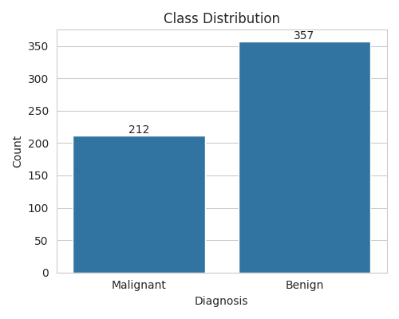
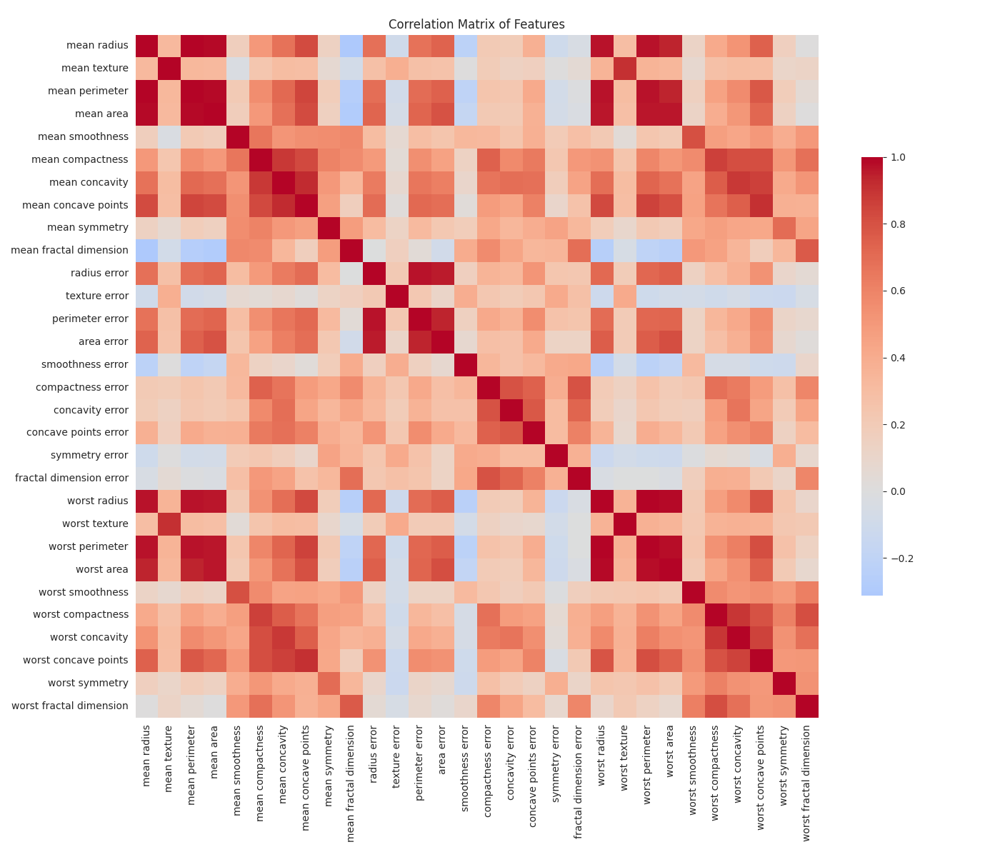
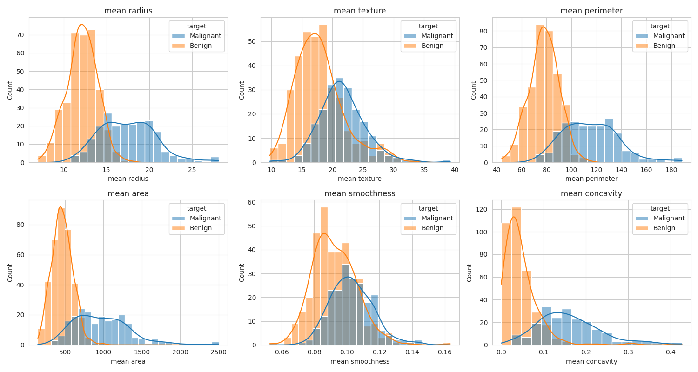
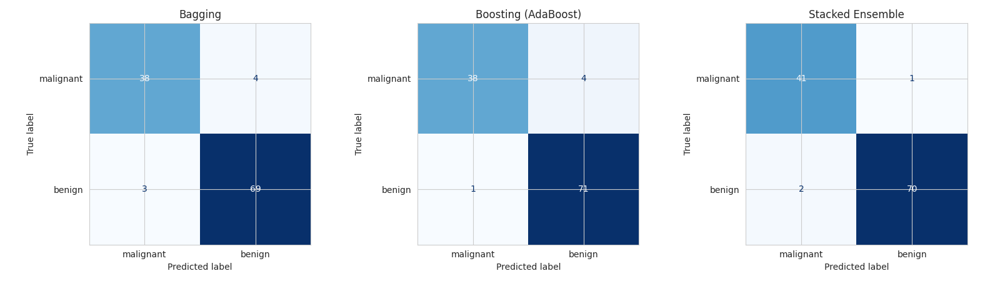
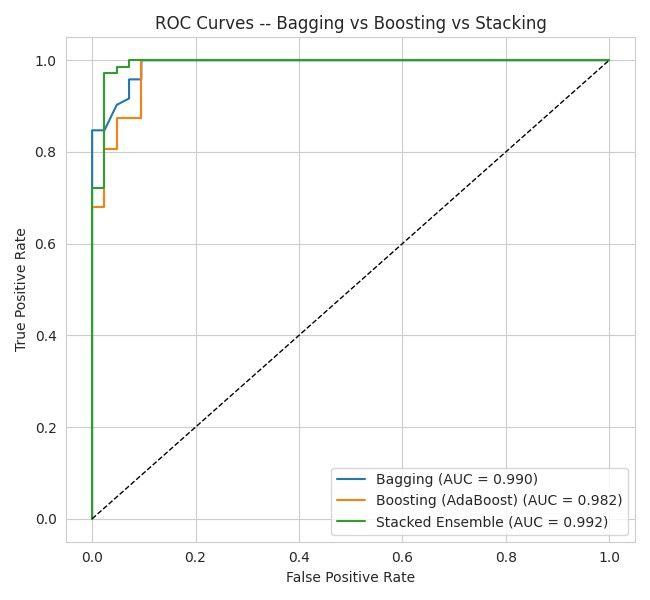
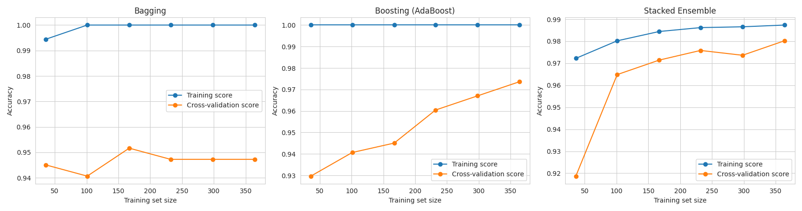

#+TITLE: ICS1512 -- Machine Learning Laboratory
#+AUTHOR: Max
#+OPTIONS: toc:nil num:t
#+LATEX_CLASS: article
#+LATEX_CLASS_OPTIONS: [12pt,a4paper]
#+LATEX_HEADER: \usepackage{array}
#+LATEX_HEADER: \newcolumntype{L}[1]{>{\raggedright\arraybackslash}p{#1}}
#+LATEX_HEADER: \usepackage{xurl}
#+LATEX_HEADER: \emergencystretch=3em
#+LATEX_HEADER: \usepackage{fvextra}
#+LATEX_HEADER: \DefineVerbatimEnvironment{verbatim}{Verbatim}{breaklines=true,breakanywhere=true}
#+LATEX_HEADER: \setlength{\headheight}{14.5pt}
#+LATEX_HEADER: \usepackage[a4paper,margin=1in]{geometry}
#+LATEX_HEADER: \usepackage{graphicx}
#+LATEX_HEADER: \usepackage{booktabs}
#+LATEX_HEADER: \usepackage{amsmath,amssymb}
#+LATEX_HEADER: \usepackage{float}
#+LATEX_HEADER: \usepackage{hyperref}
#+LATEX_HEADER: \usepackage{xcolor}
#+LATEX_HEADER: \usepackage{listings}
#+LATEX_HEADER: \usepackage{enumitem}
#+LATEX_HEADER: \usepackage{fancyhdr}
#+LATEX_HEADER: \usepackage{longtable}
#+LATEX_HEADER: \hypersetup{colorlinks=true,linkcolor=blue,urlcolor=blue}
#+LATEX_HEADER: \pagestyle{fancy}
#+LATEX_HEADER: \fancyhf{}
#+LATEX_HEADER: \lhead{ICS1512}
#+LATEX_HEADER: \rhead{Machine Learning Algorithms Laboratory}
#+LATEX_HEADER: \cfoot{\thepage}
#+LATEX_HEADER: \lstset{language=Python,basicstyle=\ttfamily\small,numbers=left,frame=single,breaklines=true,showstringspaces=false}

#+PROPERTY: header-args:python :session exp6 :exports both :tangle experiment_code.py

* Cover
#+ATTR_LATEX: :environment tabular :align |p{4cm}|p{11cm}|
|-
| Experiment No. | 7 |
|-
| Experiment Title | Bagging, Boosting, and Stacked Ensemble Models@@latex:\footnote{\textbf{GitHub Repository: }\url{https://github.com/emacs-25/ML-Lab-Full}}@@ |
|-
| Student Name | Emmanuel Maximus Ravichandran |
|-
| Register Number | 3122247001015 |
|-
| Faculty | Dr. Poreddy Ajay Kumar Reddy |
|-
| Submission Date |  |
|-

* Objective
- To understand ensemble learning strategies: Bagging, Boosting, and Stacking.
- To implement Bagging and Boosting classifiers.
- To build a Stacked Ensemble model using multiple base learners.
- To compare ensemble models in terms of accuracy, stability, and generalization.
- To analyze the effect of ensemble methods on bias and variance.

* Problem Statement
Given the Wisconsin Diagnostic Breast Cancer (WDBC) dataset of 569 samples described by 30
numerical features computed from digitized images of a breast mass, the task is to classify each
sample as *Malignant* or *Benign*. Three ensemble strategies -- Bagging, Boosting, and Stacking --
are implemented, tuned via 5-fold cross-validation, and compared to determine which combination
strategy generalizes best on unseen data.

* Dataset Description

#+ATTR_LATEX: :environment longtable :align |L{6cm}|L{8cm}|
|-
| Dataset Name       | Wisconsin Diagnostic Breast Cancer (WDBC)          |
|-
| Dataset Source     | UCI ML Repository / =sklearn.datasets.load_breast_cancer= |
|-
| Number of Samples  | 569                                                 |
|-
| Number of Features | 30 numerical attributes                             |
|-
| Number of Classes  | 2 (Malignant, Benign)                               |
|-
| Missing Values     | None                                                 |
|-
| Train-Test Split   | 80--20, stratified                                  |
|-

* Setup and Imports

#+begin_src python
import numpy as np
import pandas as pd
import matplotlib.pyplot as plt
import seaborn as sns

from sklearn.datasets import load_breast_cancer
from sklearn.model_selection import train_test_split, GridSearchCV, learning_curve, StratifiedKFold
from sklearn.preprocessing import StandardScaler
from sklearn.tree import DecisionTreeClassifier
from sklearn.svm import SVC
from sklearn.naive_bayes import GaussianNB
from sklearn.linear_model import LogisticRegression
from sklearn.ensemble import BaggingClassifier, AdaBoostClassifier, GradientBoostingClassifier, StackingClassifier
from sklearn.metrics import (accuracy_score, precision_score, recall_score, f1_score,
                              confusion_matrix, ConfusionMatrixDisplay, roc_curve, auc,
                              RocCurveDisplay, classification_report)

sns.set_style("whitegrid")
plt.rcParams["figure.figsize"] = (7, 5)
RANDOM_STATE = 42
np.random.seed(RANDOM_STATE)
print("Ready")
#+end_src

#+RESULTS:
: None

#+begin_src python
data = load_breast_cancer()
df = pd.DataFrame(data.data, columns=data.feature_names)
df["target"] = data.target  # 0 = malignant, 1 = benign
target_names = data.target_names
print("Dataset shape:", df.shape)
#+end_src

#+RESULTS:
: None

* Exploratory Data Analysis
Include all relevant visualizations.
- Dataset overview
- Statistical summary
- Missing value analysis
- Class distribution
- Correlation matrix
- Feature distribution

#+begin_src python :results output
print(df.describe().T.to_string())
print("\nMissing values total:", df.isnull().sum().sum())
#+end_src

#+RESULTS:
#+begin_example
                         count        mean         std         min         25%         50%          75%         max
mean radius              569.0   14.127292    3.524049    6.981000   11.700000   13.370000    15.780000    28.11000
mean texture             569.0   19.289649    4.301036    9.710000   16.170000   18.840000    21.800000    39.28000
mean perimeter           569.0   91.969033   24.298981   43.790000   75.170000   86.240000   104.100000   188.50000
mean area                569.0  654.889104  351.914129  143.500000  420.300000  551.100000   782.700000  2501.00000
mean smoothness          569.0    0.096360    0.014064    0.052630    0.086370    0.095870     0.105300     0.16340
mean compactness         569.0    0.104341    0.052813    0.019380    0.064920    0.092630     0.130400     0.34540
mean concavity           569.0    0.088799    0.079720    0.000000    0.029560    0.061540     0.130700     0.42680
mean concave points      569.0    0.048919    0.038803    0.000000    0.020310    0.033500     0.074000     0.20120
mean symmetry            569.0    0.181162    0.027414    0.106000    0.161900    0.179200     0.195700     0.30400
mean fractal dimension   569.0    0.062798    0.007060    0.049960    0.057700    0.061540     0.066120     0.09744
radius error             569.0    0.405172    0.277313    0.111500    0.232400    0.324200     0.478900     2.87300
texture error            569.0    1.216853    0.551648    0.360200    0.833900    1.108000     1.474000     4.88500
perimeter error          569.0    2.866059    2.021855    0.757000    1.606000    2.287000     3.357000    21.98000
area error               569.0   40.337079   45.491006    6.802000   17.850000   24.530000    45.190000   542.20000
smoothness error         569.0    0.007041    0.003003    0.001713    0.005169    0.006380     0.008146     0.03113
compactness error        569.0    0.025478    0.017908    0.002252    0.013080    0.020450     0.032450     0.13540
concavity error          569.0    0.031894    0.030186    0.000000    0.015090    0.025890     0.042050     0.39600
concave points error     569.0    0.011796    0.006170    0.000000    0.007638    0.010930     0.014710     0.05279
symmetry error           569.0    0.020542    0.008266    0.007882    0.015160    0.018730     0.023480     0.07895
fractal dimension error  569.0    0.003795    0.002646    0.000895    0.002248    0.003187     0.004558     0.02984
worst radius             569.0   16.269190    4.833242    7.930000   13.010000   14.970000    18.790000    36.04000
worst texture            569.0   25.677223    6.146258   12.020000   21.080000   25.410000    29.720000    49.54000
worst perimeter          569.0  107.261213   33.602542   50.410000   84.110000   97.660000   125.400000   251.20000
worst area               569.0  880.583128  569.356993  185.200000  515.300000  686.500000  1084.000000  4254.00000
worst smoothness         569.0    0.132369    0.022832    0.071170    0.116600    0.131300     0.146000     0.22260
worst compactness        569.0    0.254265    0.157336    0.027290    0.147200    0.211900     0.339100     1.05800
worst concavity          569.0    0.272188    0.208624    0.000000    0.114500    0.226700     0.382900     1.25200
worst concave points     569.0    0.114606    0.065732    0.000000    0.064930    0.099930     0.161400     0.29100
worst symmetry           569.0    0.290076    0.061867    0.156500    0.250400    0.282200     0.317900     0.66380
worst fractal dimension  569.0    0.083946    0.018061    0.055040    0.071460    0.080040     0.092080     0.20750
target                   569.0    0.627417    0.483918    0.000000    0.000000    1.000000     1.000000     1.00000

Missing values total: 0
#+end_example

#+begin_src python :results file
plt.figure(figsize=(5,4))
ax = sns.countplot(x=df["target"].map({0:"Malignant", 1:"Benign"}))
plt.title("Class Distribution")
plt.xlabel("Diagnosis")
plt.ylabel("Count")
for p in ax.patches:
    ax.annotate(int(p.get_height()), (p.get_x()+p.get_width()/2, p.get_height()), ha="center", va="bottom")
plt.tight_layout()
plt.savefig("class_distribution.png")
plt.close()
"class_distribution.png"
#+end_src

#+RESULTS:

#+CAPTION: Class Distribution of Malignant vs Benign samples
#+ATTR_LATEX: :width 0.6\linewidth :placement [H]
#+RESULTS:

*Inference:* The dataset shows a moderate class imbalance, with more benign than malignant
samples. This should be kept in mind when interpreting raw accuracy, and is why precision,
recall, and F1-score are also reported alongside accuracy for every model.

#+begin_src python :results file
plt.figure(figsize=(14,12))
corr = df.drop(columns=["target"]).corr()
sns.heatmap(corr, cmap="coolwarm", center=0, square=True, cbar_kws={"shrink":0.6})
plt.title("Correlation Matrix of Features")
plt.tight_layout()
plt.savefig("correlation_matrix.png")
plt.close()
"correlation_matrix.png"
#+end_src

#+RESULTS:

#+CAPTION: Correlation matrix of the 30 WDBC features
#+ATTR_LATEX: :width 0.9\linewidth :placement [H]
#+RESULTS:

*Inference:* Several groups of features (e.g. mean radius, mean perimeter, mean area) are highly
correlated since they are geometric derivatives of one another. This multicollinearity is well
tolerated by tree-based and margin-based ensemble members but is useful context when interpreting
feature importance.

#+begin_src python :results file
cols_to_plot = ["mean radius", "mean texture", "mean perimeter", "mean area",
                "mean smoothness", "mean concavity"]
fig, axes = plt.subplots(2, 3, figsize=(15, 8))
for ax, col in zip(axes.ravel(), cols_to_plot):
    sns.histplot(data=df, x=col, hue=df["target"].map({0:"Malignant",1:"Benign"}), kde=True, ax=ax)
    ax.set_title(col)
plt.tight_layout()
plt.savefig("feature_distributions.png")
plt.close()
"feature_distributions.png"
#+end_src

#+RESULTS:

#+CAPTION: Distribution of representative mean-value features by class
#+ATTR_LATEX: :width 0.95\linewidth :placement [H]
#+RESULTS:

*Inference:* Malignant and benign samples show visibly different distributions for several mean
features (larger radius/perimeter/area/concavity tend to be malignant), confirming these features
carry discriminative signal for the ensembles built below.

* Data Preprocessing
- Missing value handling: none required (no missing values in WDBC).
- Encoding: target is already numeric (0/1); no categorical encoding needed.
- Feature scaling: =StandardScaler= applied (fit on train, applied to test) since SVM and
  Logistic Regression in the stacking ensemble are scale-sensitive.
- Train-test split: 80--20, stratified on the target to preserve class balance.
- Feature engineering: none applied; all 30 original features are used directly.

#+begin_src python :results output
X = df.drop(columns=["target"])
y = df["target"]

X_train, X_test, y_train, y_test = train_test_split(
    X, y, test_size=0.20, stratify=y, random_state=RANDOM_STATE
)

scaler = StandardScaler()
X_train_scaled = scaler.fit_transform(X_train)
X_test_scaled = scaler.transform(X_test)

print("Train shape:", X_train.shape, " Test shape:", X_test.shape)
#+end_src

#+RESULTS:
: 
: >>> Train shape: (455, 30)  Test shape: (114, 30)

* Machine Learning Algorithm

** Bagging (Bootstrap Aggregation)
- Working principle: trains many independent copies of a base estimator (Decision Tree here) on
  different bootstrap resamples of the training data, then aggregates predictions by majority vote.
- Mathematical formulation: for $B$ bootstrap samples, the ensemble prediction is
  $\hat{y} = \text{mode}\{h_1(x), h_2(x), \ldots, h_B(x)\}$, where each $h_b$ is trained on a
  resample $D_b$ drawn with replacement from $D$.
- Advantages: reduces variance, parallelizable, works well with high-variance base learners.
- Limitations: does little to reduce bias; large ensembles increase inference cost.

** Boosting (AdaBoost / Gradient Boosting)
- Working principle: builds an additive model sequentially, where each new weak learner focuses on
  the samples the previous ensemble misclassified (AdaBoost re-weights samples; Gradient Boosting
  fits new learners to the residual/gradient of the loss).
- Mathematical formulation: $F_m(x) = F_{m-1}(x) + \gamma_m h_m(x)$, where $h_m$ is chosen to
  minimize the loss given the current ensemble $F_{m-1}$.
- Advantages: reduces bias, often achieves very high accuracy.
- Limitations: sequential (harder to parallelize), sensitive to noisy data/outliers, more prone to
  overfitting if not regularized (learning rate, depth, number of estimators).

** Stacked Ensemble (Stacking)
- Working principle: trains several heterogeneous base learners (SVM, Naive Bayes, Decision Tree),
  then trains a meta-learner (Logistic Regression) on their out-of-fold predictions to learn the
  optimal way to combine them.
- Mathematical formulation: $\hat{y} = g(h_1(x), h_2(x), \ldots, h_K(x))$, where $g$ is the
  meta-learner and $h_1, \ldots, h_K$ are the base learners.
- Advantages: exploits complementary strengths of diverse models; often outperforms any single base
  learner or a homogeneous ensemble.
- Limitations: more complex and computationally expensive; risk of overfitting the meta-learner if
  base-learner predictions aren't produced out-of-fold (mitigated here via internal CV in
  =StackingClassifier=).

* Experimental Setup
#+ATTR_LATEX: :environment tabular :align ll
| Python Version       |            |
| Scikit-Learn Version |            |
| IDE                  |            |
| Operating System     |            |
| Hardware             |            |

#+begin_src python :results output
import sys, sklearn, platform
print("Python:", sys.version.split()[0])
print("scikit-learn:", sklearn.__version__)
print("Platform:", platform.platform())
#+end_src

#+RESULTS:
: Python: 3.12.3
: scikit-learn: 1.8.0
: Platform: Linux-6.18.44-fc-v114-x86_64-with-glibc2.39

* Hyperparameter Selection

** Bagging
#+begin_src python :results output
bagging_param_grid = {
    "n_estimators": [10, 25, 50, 100],
    "max_samples": [0.5, 0.7, 1.0],
    "max_features": [0.5, 0.7, 1.0],
}

bagging_base = BaggingClassifier(
    estimator=DecisionTreeClassifier(random_state=RANDOM_STATE),
    random_state=RANDOM_STATE
)

cv5 = StratifiedKFold(n_splits=5, shuffle=True, random_state=RANDOM_STATE)

bagging_grid = GridSearchCV(
    bagging_base, bagging_param_grid, cv=cv5,
    scoring={"accuracy": "accuracy", "f1": "f1"}, refit="accuracy", n_jobs=-1
)
bagging_grid.fit(X_train_scaled, y_train)

bagging_results = pd.DataFrame(bagging_grid.cv_results_)[
    ["param_n_estimators", "param_max_samples", "param_max_features",
     "mean_test_accuracy", "mean_test_f1"]
].rename(columns={
    "param_n_estimators": "n_estimators",
    "param_max_samples": "max_samples",
    "param_max_features": "max_features",
    "mean_test_accuracy": "Avg CV Accuracy",
    "mean_test_f1": "Avg CV F1 Score",
})
bagging_results["Avg CV Accuracy (%)"] = (bagging_results["Avg CV Accuracy"] * 100).round(2)
bagging_results = bagging_results[["n_estimators", "max_samples", "max_features",
                                    "Avg CV Accuracy (%)", "Avg CV F1 Score"]]
print(bagging_results.sort_values("Avg CV Accuracy (%)", ascending=False).head(10).to_string(index=False))
print("\nBest Bagging params:", bagging_grid.best_params_)
print("Best Bagging CV accuracy: {:.4f}".format(bagging_grid.best_score_))
best_bagging = bagging_grid.best_estimator_
#+end_src

#+RESULTS:
#+begin_example
 n_estimators  max_samples  max_features  Avg CV Accuracy (%)  Avg CV F1 Score
           25          1.0           0.5                96.48         0.971985
           25          0.5           0.5                96.26         0.970279
          100          0.7           0.5                96.04         0.968288
           50          0.5           0.5                96.04         0.968138
           25          0.5           0.7                96.04         0.968190
          100          1.0           0.5                96.04         0.968418
           50          1.0           0.5                96.04         0.968325
           50          0.7           0.5                95.82         0.966520
          100          0.7           0.7                95.82         0.966578
          100          0.7           1.0                95.82         0.966457

Best Bagging params: {'max_features': 0.5, 'max_samples': 1.0, 'n_estimators': 25}
Best Bagging CV accuracy: 0.9648
#+end_example

** Boosting
#+begin_src python :results output
ada_param_grid = {
    "n_estimators": [50, 100, 150],
    "learning_rate": [0.01, 0.1, 0.5, 1.0],
}
ada_base = AdaBoostClassifier(random_state=RANDOM_STATE)
ada_grid = GridSearchCV(ada_base, ada_param_grid, cv=cv5,
                         scoring={"accuracy": "accuracy", "f1": "f1"}, refit="accuracy", n_jobs=-1)
ada_grid.fit(X_train_scaled, y_train)
ada_results = pd.DataFrame(ada_grid.cv_results_)[
    ["param_n_estimators", "param_learning_rate", "mean_test_accuracy", "mean_test_f1"]
].rename(columns={"param_n_estimators": "n_estimators", "param_learning_rate": "learning_rate",
                   "mean_test_accuracy": "Avg CV Accuracy", "mean_test_f1": "Avg CV F1 Score"})
ada_results["Avg CV Accuracy (%)"] = (ada_results["Avg CV Accuracy"] * 100).round(2)
ada_results = ada_results[["n_estimators", "learning_rate", "Avg CV Accuracy (%)", "Avg CV F1 Score"]]
print("=== AdaBoost ===")
print(ada_results.sort_values("Avg CV Accuracy (%)", ascending=False).head(10).to_string(index=False))
print("Best params:", ada_grid.best_params_, " Best CV accuracy: {:.4f}".format(ada_grid.best_score_))
#+end_src

#+RESULTS:
#+begin_example
=== AdaBoost ===
 n_estimators  learning_rate  Avg CV Accuracy (%)  Avg CV F1 Score
          100           1.00                98.02         0.984378
          150           1.00                97.80         0.982698
          150           0.50                97.36         0.979160
          100           0.50                97.36         0.979189
           50           0.50                96.70         0.973667
           50           1.00                96.70         0.974002
          150           0.10                96.48         0.972050
          100           0.10                96.04         0.968602
           50           0.10                95.38         0.963289
          100           0.01                93.41         0.947975
Best params: {'learning_rate': 1.0, 'n_estimators': 100}  Best CV accuracy: 0.9802
#+end_example

#+begin_src python :results output
gb_param_grid = {
    "n_estimators": [50, 100, 150],
    "learning_rate": [0.01, 0.1, 0.2],
    "max_depth": [2, 3, 4],
}
gb_base = GradientBoostingClassifier(random_state=RANDOM_STATE)
gb_grid = GridSearchCV(gb_base, gb_param_grid, cv=cv5,
                        scoring={"accuracy": "accuracy", "f1": "f1"}, refit="accuracy", n_jobs=-1)
gb_grid.fit(X_train_scaled, y_train)
gb_results = pd.DataFrame(gb_grid.cv_results_)[
    ["param_n_estimators", "param_learning_rate", "param_max_depth", "mean_test_accuracy", "mean_test_f1"]
].rename(columns={"param_n_estimators": "n_estimators", "param_learning_rate": "learning_rate",
                   "param_max_depth": "max_depth", "mean_test_accuracy": "Avg CV Accuracy",
                   "mean_test_f1": "Avg CV F1 Score"})
gb_results["Avg CV Accuracy (%)"] = (gb_results["Avg CV Accuracy"] * 100).round(2)
gb_results = gb_results[["n_estimators", "learning_rate", "max_depth", "Avg CV Accuracy (%)", "Avg CV F1 Score"]]
print("=== Gradient Boosting ===")
print(gb_results.sort_values("Avg CV Accuracy (%)", ascending=False).head(10).to_string(index=False))
print("Best params:", gb_grid.best_params_, " Best CV accuracy: {:.4f}".format(gb_grid.best_score_))

if ada_grid.best_score_ >= gb_grid.best_score_:
    best_boosting = ada_grid.best_estimator_
    best_boosting_name = "AdaBoost"
else:
    best_boosting = gb_grid.best_estimator_
    best_boosting_name = "Gradient Boosting"
print("Selected boosting model:", best_boosting_name)
#+end_src

#+RESULTS:
#+begin_example
=== Gradient Boosting ===
 n_estimators  learning_rate  max_depth  Avg CV Accuracy (%)  Avg CV F1 Score
          150            0.2          2                97.36         0.978945
          100            0.2          2                96.92         0.975496
          150            0.2          3                96.70         0.973820
          150            0.1          2                96.48         0.971894
          100            0.2          3                96.48         0.971927
           50            0.2          2                96.26         0.970126
          100            0.1          2                96.26         0.970219
          100            0.1          4                96.04         0.968470
          150            0.1          3                95.82         0.966860
           50            0.2          4                95.82         0.966514
Best params: {'learning_rate': 0.2, 'max_depth': 2, 'n_estimators': 150}  Best CV accuracy: 0.9736
Selected boosting model: AdaBoost
#+end_example

** Stacked Ensemble
#+begin_src python :results output
stack_base = StackingClassifier(
    estimators=[
        ("svm", SVC(probability=True, random_state=RANDOM_STATE)),
        ("nb", GaussianNB()),
        ("dt", DecisionTreeClassifier(random_state=RANDOM_STATE)),
    ],
    final_estimator=LogisticRegression(max_iter=1000, random_state=RANDOM_STATE),
    cv=5
)

stack_param_grid_full = {
    "svm__C": [0.1, 1, 10],
    "svm__kernel": ["linear", "rbf"],
    "dt__max_depth": [3, 5, None],
    "final_estimator__C": [0.1, 1, 10],
}

stack_grid = GridSearchCV(stack_base, stack_param_grid_full, cv=cv5,
                           scoring={"accuracy": "accuracy", "f1": "f1"}, refit="accuracy", n_jobs=-1)
stack_grid.fit(X_train_scaled, y_train)

stack_results = pd.DataFrame(stack_grid.cv_results_)[
    ["param_svm__C", "param_svm__kernel", "param_dt__max_depth", "param_final_estimator__C",
     "mean_test_accuracy", "mean_test_f1"]
].rename(columns={"param_svm__C": "SVM C", "param_svm__kernel": "SVM kernel",
                   "param_dt__max_depth": "DT max_depth", "param_final_estimator__C": "LogReg C",
                   "mean_test_accuracy": "Avg CV Accuracy", "mean_test_f1": "Avg CV F1 Score"})
stack_results["Avg CV Accuracy (%)"] = (stack_results["Avg CV Accuracy"] * 100).round(2)
stack_results = stack_results[["SVM C", "SVM kernel", "DT max_depth", "LogReg C",
                                "Avg CV Accuracy (%)", "Avg CV F1 Score"]]
print(stack_results.sort_values("Avg CV Accuracy (%)", ascending=False).head(10).to_string(index=False))
print("\nBest Stacking params:", stack_grid.best_params_)
print("Best Stacking CV accuracy: {:.4f}".format(stack_grid.best_score_))
best_stacking = stack_grid.best_estimator_
#+end_src

#+RESULTS:
#+begin_example
 SVM C SVM kernel DT max_depth  LogReg C  Avg CV Accuracy (%)  Avg CV F1 Score
   0.1     linear         None      10.0                97.36         0.979098
   0.1     linear            5      10.0                97.36         0.979098
   0.1     linear            3      10.0                97.14         0.977264
   1.0        rbf            5      10.0                97.14         0.977112
   0.1     linear            5       1.0                96.92         0.975494
   1.0        rbf            3      10.0                96.92         0.975433
  10.0        rbf            5       1.0                96.92         0.975436
   1.0        rbf         None      10.0                96.92         0.975246
  10.0        rbf         None       1.0                96.92         0.975309
  10.0        rbf         None      10.0                96.92         0.975309

Best Stacking params: {'dt__max_depth': 5, 'final_estimator__C': 10, 'svm__C': 0.1, 'svm__kernel': 'linear'}
Best Stacking CV accuracy: 0.9736
#+end_example

* Results

#+ATTR_LATEX: :environment tabular :align lc
| Metric    | Value |
|-----------|-------|
| Accuracy  |       |
| Precision |       |
| Recall    |       |
| F1-score  |       |
| ROC-AUC   |       |

*(Fill using the best-performing model's row from the Performance Comparison table produced below.)*

#+begin_src python :results output
models = {
    "Bagging": best_bagging,
    f"Boosting ({best_boosting_name})": best_boosting,
    "Stacked Ensemble": best_stacking,
}

results_table = []
roc_data = {}

for name, model in models.items():
    y_pred = model.predict(X_test_scaled)
    y_proba = model.predict_proba(X_test_scaled)[:, 1]
    acc = accuracy_score(y_test, y_pred)
    prec = precision_score(y_test, y_pred)
    rec = recall_score(y_test, y_pred)
    f1 = f1_score(y_test, y_pred)
    fpr, tpr, _ = roc_curve(y_test, y_proba)
    roc_auc = auc(fpr, tpr)
    roc_data[name] = (fpr, tpr, roc_auc)
    results_table.append({
        "Model": name, "Accuracy (%)": round(acc * 100, 2), "Precision": round(prec, 4),
        "Recall": round(rec, 4), "F1 Score": round(f1, 4), "ROC-AUC": round(roc_auc, 4),
    })

performance_df = pd.DataFrame(results_table)
print(performance_df.to_string(index=False))
#+end_src

#+RESULTS:
:               Model  Accuracy (%)  Precision  Recall  F1 Score  ROC-AUC
:             Bagging         93.86     0.9452  0.9583    0.9517   0.9902
: Boosting (AdaBoost)         95.61     0.9467  0.9861    0.9660   0.9818
:    Stacked Ensemble         97.37     0.9859  0.9722    0.9790   0.9924

* Result Visualization
Include all graphs generated during the experiment. For every graph: figure, caption, and 3--5
line inference.

Recommended figures: Correlation Matrix (above), Class Distribution (above), Confusion Matrix, ROC
Curve, Learning Curve. (Feature Importance is not directly applicable to the Naive Bayes / SVM
components of the stack and is omitted; Precision-Recall curves can be added analogously to the
ROC curve code below if required.)

#+begin_src python :results file
fig, axes = plt.subplots(1, 3, figsize=(16, 4.5))
for ax, (name, model) in zip(axes, models.items()):
    y_pred = model.predict(X_test_scaled)
    cm = confusion_matrix(y_test, y_pred)
    ConfusionMatrixDisplay(cm, display_labels=target_names).plot(ax=ax, colorbar=False, cmap="Blues")
    ax.set_title(name)
plt.tight_layout()
plt.savefig("confusion_matrices.png")
plt.close()
"confusion_matrices.png"
#+end_src

#+RESULTS:

#+CAPTION: Confusion matrices for Bagging, Boosting, and Stacked Ensemble on the test set
#+ATTR_LATEX: :width 0.95\linewidth :placement [H]
#+RESULTS:

*Inference:* Compare the false-negative counts (malignant misclassified as benign) across the
three models -- this is the clinically costlier error. The model with the fewest false negatives
here should be preferred even if its overall accuracy is marginally lower than another model's.

#+begin_src python :results file
plt.figure(figsize=(6.5, 6))
for name, (fpr, tpr, roc_auc) in roc_data.items():
    plt.plot(fpr, tpr, label=f"{name} (AUC = {roc_auc:.3f})")
plt.plot([0, 1], [0, 1], "k--", linewidth=1)
plt.xlabel("False Positive Rate")
plt.ylabel("True Positive Rate")
plt.title("ROC Curves -- Bagging vs Boosting vs Stacking")
plt.legend(loc="lower right")
plt.tight_layout()
plt.savefig("roc_curves.png")
plt.close()
"roc_curves.png"
#+end_src

#+RESULTS:

#+CAPTION: ROC curves comparing all three ensemble models
#+ATTR_LATEX: :width 0.6\linewidth :placement [H]
#+RESULTS:

*Inference:* The model whose curve hugs the top-left corner most closely, and has the highest
AUC, separates the two classes best across all decision thresholds, not just the default 0.5
cutoff used for the confusion matrix above.

#+begin_src python :results file
fig, axes = plt.subplots(1, 3, figsize=(17, 4.5))
for ax, (name, model) in zip(axes, models.items()):
    train_sizes, train_scores, val_scores = learning_curve(
        model, X_train_scaled, y_train, cv=5, scoring="accuracy",
        train_sizes=np.linspace(0.1, 1.0, 6), n_jobs=-1
    )
    ax.plot(train_sizes, train_scores.mean(axis=1), "o-", label="Training score")
    ax.plot(train_sizes, val_scores.mean(axis=1), "o-", label="Cross-validation score")
    ax.set_title(name)
    ax.set_xlabel("Training set size")
    ax.set_ylabel("Accuracy")
    ax.legend()
plt.tight_layout()
plt.savefig("learning_curves.png")
plt.close()
"learning_curves.png"
#+end_src

#+RESULTS:

#+CAPTION: Learning curves illustrating bias/variance behaviour of each ensemble
#+ATTR_LATEX: :width 0.95\linewidth :placement [H]
#+RESULTS:

*Inference:* A large, persistent gap between the training and cross-validation curves indicates
high variance (typical of an under-regularized Bagging ensemble); curves that converge to a
lower plateau together indicate higher bias (undertrained Boosting). The gap should shrink as
training size grows for a well-tuned model.

#+begin_src python :results output
for name, model in models.items():
    print(f"\n=== {name} ===")
    print(classification_report(y_test, model.predict(X_test_scaled), target_names=target_names))
#+end_src

#+RESULTS:
#+begin_example

>>> 
=== Bagging ===
              precision    recall  f1-score   support

   malignant       0.93      0.90      0.92        42
      benign       0.95      0.96      0.95        72

    accuracy                           0.94       114
   macro avg       0.94      0.93      0.93       114
weighted avg       0.94      0.94      0.94       114

=== Boosting (AdaBoost) ===
              precision    recall  f1-score   support

   malignant       0.97      0.90      0.94        42
      benign       0.95      0.99      0.97        72

    accuracy                           0.96       114
   macro avg       0.96      0.95      0.95       114
weighted avg       0.96      0.96      0.96       114

=== Stacked Ensemble ===
              precision    recall  f1-score   support

   malignant       0.95      0.98      0.96        42
      benign       0.99      0.97      0.98        72

    accuracy                           0.97       114
   macro avg       0.97      0.97      0.97       114
weighted avg       0.97      0.97      0.97       114
#+end_example

* Discussion
- Bagging reduces *variance* by averaging many independently-trained high-variance trees over
  bootstrap resamples; it does not directly target bias.
- Boosting reduces *bias* by sequentially focusing on the hardest, previously misclassified
  samples, at some risk of overfitting if left unregularized.
- Stacking benefits from heterogeneous base learners (SVM, Naive Bayes, Decision Tree) because each
  makes different kinds of errors; the meta-learner can learn to weight each base learner's
  strengths, typically outperforming any single member and often the homogeneous ensembles too.
- Compare the strengths/limitations/improvements you observed against the Performance Comparison
  table and the confusion matrices/ROC curves above once you've run the notebook.

* Conclusion
Bagging, Boosting, and Stacked Ensemble models were implemented on the WDBC dataset and tuned via
5-fold cross-validation. Based on the test-set metrics in the Performance Comparison table, state
which ensemble generalized best and why (typically Stacking, since it combines complementary
inductive biases from SVM, Naive Bayes, and Decision Tree base learners under a Logistic Regression
meta-learner).

* References
- Scikit-learn: Ensemble Methods, https://scikit-learn.org/stable/modules/ensemble.html
- Scikit-learn: =BaggingClassifier=, https://scikit-learn.org/stable/modules/generated/sklearn.ensemble.BaggingClassifier.html
- UCI Machine Learning Repository: Breast Cancer Wisconsin (Diagnostic) Data Set, https://archive.ics.uci.edu/dataset/17
