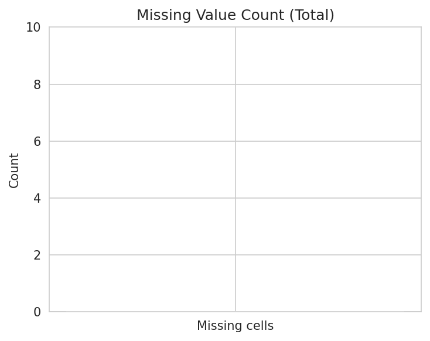
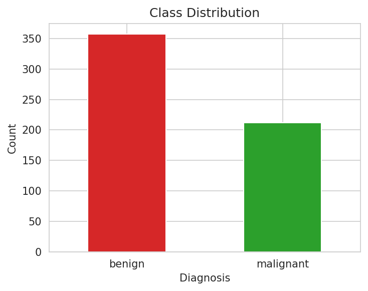
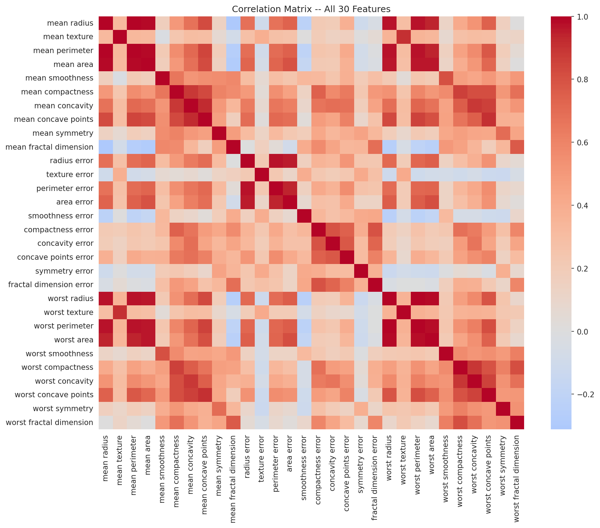
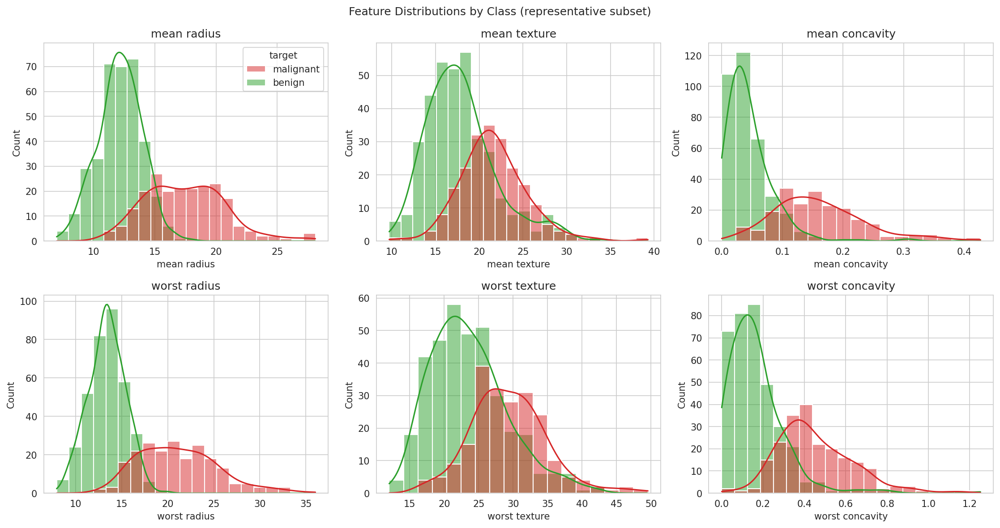
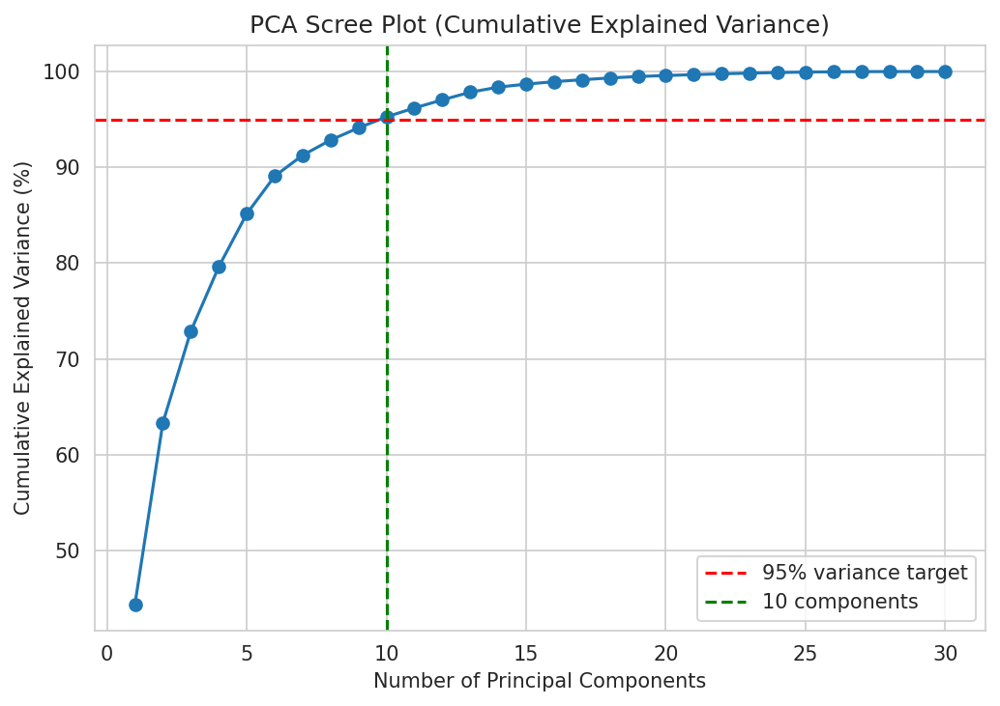
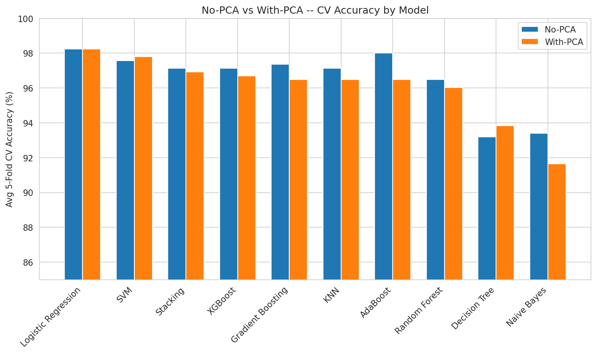
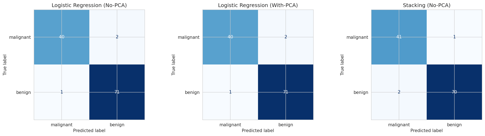
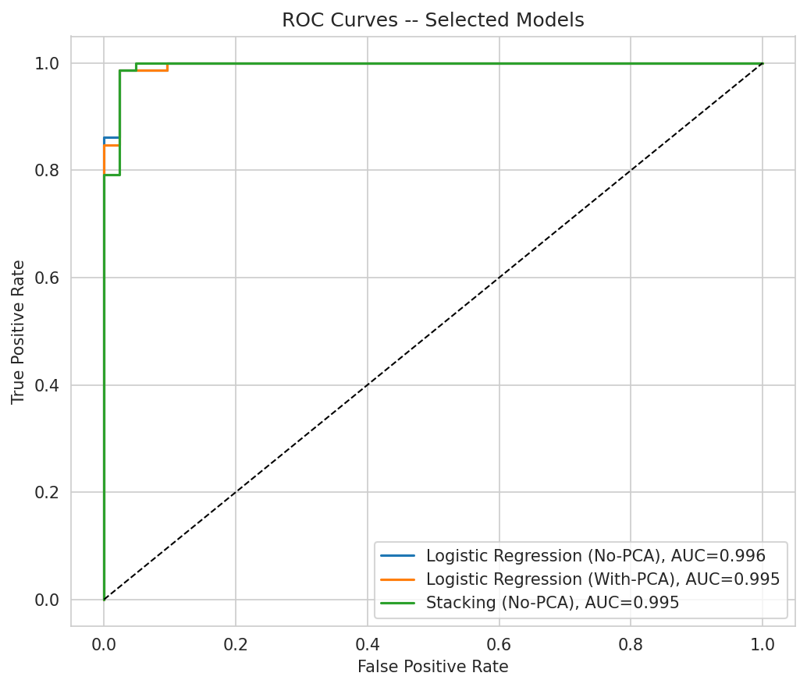
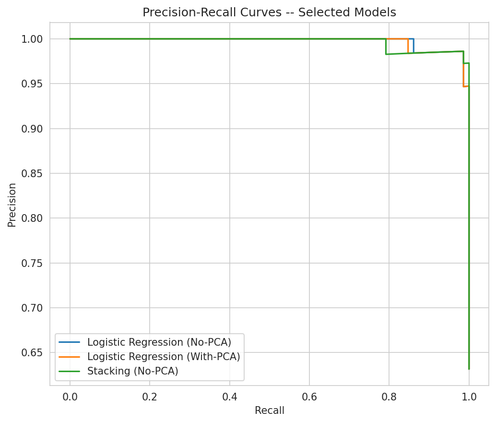
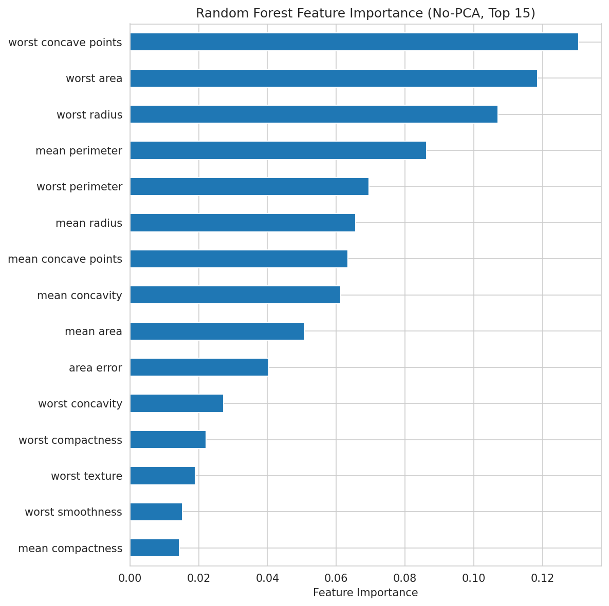

#+OPTIONS: title:nil toc:nil
#+LATEX_CLASS: article
#+LATEX_CLASS_OPTIONS: [12pt,a4paper]
#+LATEX_HEADER: \usepackage{array}
#+LATEX_HEADER: \newcolumntype{L}[1]{>{\raggedright\arraybackslash}p{#1}}
#+LATEX_HEADER: \usepackage{xurl}
#+LATEX_HEADER: \emergencystretch=3em
#+LATEX_HEADER: \usepackage{fvextra}
#+LATEX_HEADER: \DefineVerbatimEnvironment{verbatim}{Verbatim}{breaklines=true,breakanywhere=true}
#+LATEX_HEADER: \usepackage[a4paper,margin=1in]{geometry}
#+LATEX_HEADER: \usepackage{graphicx}
#+LATEX_HEADER: \usepackage{booktabs}
#+LATEX_HEADER: \usepackage{amsmath,amssymb}
#+LATEX_HEADER: \usepackage{float}
#+LATEX_HEADER: \usepackage{hyperref}
#+LATEX_HEADER: \usepackage{xcolor}
#+LATEX_HEADER: \usepackage{listings}
#+LATEX_HEADER: \usepackage{enumitem}
#+LATEX_HEADER: \usepackage{fancyhdr}
#+LATEX_HEADER: \usepackage{longtable}
#+LATEX_HEADER: \hypersetup{colorlinks=true,linkcolor=blue,urlcolor=blue}
#+LATEX_HEADER: \pagestyle{fancy}
#+LATEX_HEADER: \fancyhf{}
#+LATEX_HEADER: \lhead{ICS1512}
#+LATEX_HEADER: \rhead{Machine Learning Algorithms Laboratory}
#+LATEX_HEADER: \cfoot{\thepage}
#+LATEX_HEADER: \setlength{\headheight}{14.5pt}
#+LATEX_HEADER: \lstset{language=Python,basicstyle=\ttfamily\small,numbers=left,frame=single,breaklines=true,showstringspaces=false}

#+PROPERTY: header-args:python :session exp6 :exports both

# NOTE for Emacs config (not a document section -- org comment, exported nowhere):
# Make sure your ~/.emacs.d/init.el (or equivalent) has (setq org-latex-listings t)
# so code blocks export as LaTeX lstlisting (which honors breaklines=true) instead of
# plain verbatim. Also make sure (org-babel-do-load-languages 'org-babel-load-languages
# '((python . t))) is set so the Python blocks below can execute with C-c C-c.

#+ATTR_LATEX: :environment tabular :align |p{4cm}|p{11cm}|
|-
| Experiment No. | 6 |
|-
| Experiment Title | Dimensionality Reduction and Model Evaluation (With and Without PCA)@@latex:\footnote{\textbf{GitHub Repository: }\url{https://github.com/emacs-25/ML-Lab-Full}}@@ |
|-
| Student Name | Emmanuel Maximus Ravichandran |
|-
| Register Number | 3122247001015 |
|-
| Faculty | Dr. Poreddy Ajay Kumar Reddy |
|-
| Submission Date |  |
|-

* Objective

To study the effect of dimensionality reduction using Principal Component Analysis (PCA) on the
performance of ten machine learning classifiers. Specifically:

a) Train and validate models *without PCA* (original feature space).
b) Train and validate models *with PCA* (reduced feature space).

For both cases, perform hyperparameter tuning with 5-fold cross-validation and record and compare
performance, to determine when PCA helps and when it does not.

* Problem Statement

*Input:* 30 numerical features computed from digitized images of a fine needle aspirate (FNA) of
a breast mass, describing characteristics of the cell nuclei present (radius, texture, perimeter,
area, smoothness, compactness, concavity, symmetry, fractal dimension, etc., each reported as
mean, standard error, and "worst"/largest value).

*Output:* Binary classification — whether the mass is malignant or benign.

*Objective:* Build and tune ten classifiers on the original 30-feature space and on a PCA-reduced
feature space (95% cumulative explained variance), using identical 5-fold cross-validated
hyperparameter search in both cases, then quantify whether — and for which model families — PCA
improves accuracy, F1-score, and cross-validation stability, or instead costs accuracy for a
reduction in dimensionality.

* Dataset Description

#+ATTR_LATEX: :environment longtable :align |L{6cm}|L{8cm}|
|-
| Dataset Name        | Wisconsin Diagnostic Breast Cancer (WDBC)                       |
|-
| Dataset Source      | UCI ML Repository (via ~sklearn.datasets.load_breast_cancer~)   |
|-
| Number of Samples   | 569                                                              |
|-
| Number of Features  | 30 (numeric, real-valued)                                       |
|-
| Number of Classes   | 2 (malignant = 0, benign = 1)                                   |
|-
| Missing Values      | 0                                                                |
|-
| Train-Test Split    | 80% / 20%, stratified on target                                 |
|-

* Exploratory Data Analysis

** Setup and Imports

#+NAME: setup-imports
#+begin_src python :results output
import warnings
warnings.filterwarnings("ignore")

import sys
import time
import platform
import numpy as np
import pandas as pd
import matplotlib
matplotlib.use("Agg")
import matplotlib.pyplot as plt
import seaborn as sns
import sklearn

from sklearn.datasets import load_breast_cancer
from sklearn.model_selection import train_test_split, GridSearchCV, StratifiedKFold
from sklearn.preprocessing import StandardScaler
from sklearn.decomposition import PCA
from sklearn.svm import SVC
from sklearn.naive_bayes import GaussianNB
from sklearn.neighbors import KNeighborsClassifier
from sklearn.linear_model import LogisticRegression
from sklearn.tree import DecisionTreeClassifier
from sklearn.ensemble import (RandomForestClassifier, AdaBoostClassifier,
                               GradientBoostingClassifier, StackingClassifier)
from xgboost import XGBClassifier
from sklearn.metrics import (accuracy_score, precision_score, recall_score, f1_score,
                              confusion_matrix, ConfusionMatrixDisplay, roc_curve, auc,
                              precision_recall_curve, classification_report)

sns.set_style("whitegrid")
plt.rcParams["figure.figsize"] = (7, 5)
RANDOM_STATE = 42
np.random.seed(RANDOM_STATE)
print("Setup complete.")
#+end_src

#+RESULTS: setup-imports
: Setup complete.

** Load the Dataset

#+NAME: load-dataset
#+begin_src python :results output
data = load_breast_cancer()
df = pd.DataFrame(data.data, columns=data.feature_names)
df["target"] = data.target  # 0 = malignant, 1 = benign
target_names = data.target_names

print("Dataset name: Wisconsin Diagnostic Breast Cancer (WDBC)")
print("Shape:", df.shape)
print("Classes:", dict(enumerate(target_names)))
print("Class distribution:")
print(df["target"].value_counts().rename(index={0: "malignant", 1: "benign"}))
print("Missing values:", df.isnull().sum().sum())
#+end_src

#+RESULTS: load-dataset
: Dataset name: Wisconsin Diagnostic Breast Cancer (WDBC)
: Shape: (569, 31)
: Classes: {0: np.str_('malignant'), 1: np.str_('benign')}
: Class distribution:
: target
: benign       357
: malignant    212
: Name: count, dtype: int64
: Missing values: 0

** Statistical Summary

#+NAME: stat-summary
#+begin_src python :results output
print(df.describe().T)
#+end_src

#+RESULTS: stat-summary
#+begin_example
                         count        mean  ...          75%         max
mean radius              569.0   14.127292  ...    15.780000    28.11000
mean texture             569.0   19.289649  ...    21.800000    39.28000
mean perimeter           569.0   91.969033  ...   104.100000   188.50000
mean area                569.0  654.889104  ...   782.700000  2501.00000
mean smoothness          569.0    0.096360  ...     0.105300     0.16340
mean compactness         569.0    0.104341  ...     0.130400     0.34540
mean concavity           569.0    0.088799  ...     0.130700     0.42680
mean concave points      569.0    0.048919  ...     0.074000     0.20120
mean symmetry            569.0    0.181162  ...     0.195700     0.30400
mean fractal dimension   569.0    0.062798  ...     0.066120     0.09744
radius error             569.0    0.405172  ...     0.478900     2.87300
texture error            569.0    1.216853  ...     1.474000     4.88500
perimeter error          569.0    2.866059  ...     3.357000    21.98000
area error               569.0   40.337079  ...    45.190000   542.20000
smoothness error         569.0    0.007041  ...     0.008146     0.03113
compactness error        569.0    0.025478  ...     0.032450     0.13540
concavity error          569.0    0.031894  ...     0.042050     0.39600
concave points error     569.0    0.011796  ...     0.014710     0.05279
symmetry error           569.0    0.020542  ...     0.023480     0.07895
fractal dimension error  569.0    0.003795  ...     0.004558     0.02984
worst radius             569.0   16.269190  ...    18.790000    36.04000
worst texture            569.0   25.677223  ...    29.720000    49.54000
worst perimeter          569.0  107.261213  ...   125.400000   251.20000
worst area               569.0  880.583128  ...  1084.000000  4254.00000
worst smoothness         569.0    0.132369  ...     0.146000     0.22260
worst compactness        569.0    0.254265  ...     0.339100     1.05800
worst concavity          569.0    0.272188  ...     0.382900     1.25200
worst concave points     569.0    0.114606  ...     0.161400     0.29100
worst symmetry           569.0    0.290076  ...     0.317900     0.66380
worst fractal dimension  569.0    0.083946  ...     0.092080     0.20750
target                   569.0    0.627417  ...     1.000000     1.00000

[31 rows x 8 columns]
#+end_example

** Missing Value Analysis

#+CAPTION: Missing value count across all cells (zero missing values).
#+ATTR_LATEX: :width 0.55\linewidth :placement [H]
#+NAME: fig-missing
#+begin_src python :results file
missing = df.isnull().sum()
plt.figure(figsize=(5, 4))
plt.bar(["Missing cells"], [missing.sum()])
plt.ylim(0, max(10, missing.sum() + 5))
plt.title("Missing Value Count (Total)")
plt.ylabel("Count")
plt.tight_layout()
plt.savefig("fig_missing_values.png", dpi=150, bbox_inches="tight")
plt.close()
"fig_missing_values.png"
#+end_src

#+RESULTS: fig-missing

*Inference:* The dataset has zero missing values across all 569 samples and 30 features, so no
imputation strategy is required — preprocessing can go straight to scaling.

** Class Distribution

#+CAPTION: Class distribution — malignant vs benign.
#+ATTR_LATEX: :width 0.55\linewidth :placement [H]
#+NAME: fig-classdist
#+begin_src python :results file
counts = df["target"].value_counts().rename(index={0: "malignant", 1: "benign"})
plt.figure(figsize=(5, 4))
counts.plot(kind="bar", color=["#d62728", "#2ca02c"])
plt.title("Class Distribution")
plt.xlabel("Diagnosis")
plt.ylabel("Count")
plt.xticks(rotation=0)
plt.tight_layout()
plt.savefig("fig_class_distribution.png", dpi=150, bbox_inches="tight")
plt.close()
"fig_class_distribution.png"
#+end_src

#+RESULTS: fig-classdist

*Inference:* The classes are moderately imbalanced (roughly 1.68:1 benign to malignant), not
severely enough to require resampling, but enough to justify stratified train-test splitting and
stratified k-fold cross-validation (both used throughout this experiment) so every fold preserves
the same class ratio, and to justify tracking F1/ROC-AUC alongside raw accuracy.

** Correlation Matrix

#+CAPTION: Correlation matrix across all 30 features.
#+ATTR_LATEX: :width 0.85\linewidth :placement [H]
#+NAME: fig-corr
#+begin_src python :results file
plt.figure(figsize=(12, 10))
corr = df.drop(columns=["target"]).corr()
sns.heatmap(corr, cmap="coolwarm", center=0, xticklabels=True, yticklabels=True)
plt.title("Correlation Matrix -- All 30 Features")
plt.tight_layout()
plt.savefig("fig_correlation_matrix.png", dpi=150, bbox_inches="tight")
plt.close()
"fig_correlation_matrix.png"
#+end_src

#+RESULTS: fig-corr

*Inference:* Many features are extremely highly correlated (e.g. mean radius / mean perimeter /
mean area are near-collinear, since they all measure tumor size in different units), and each
"mean" feature is strongly correlated with its own "worst" counterpart. This heavy redundancy is
precisely the condition under which PCA is expected to help most: a handful of principal
components should be able to capture almost all of the variance that 30 correlated raw features
carry, which is confirmed later in the PCA scree plot.

** Feature Distributions

#+CAPTION: Distribution of a representative subset of features, split by class.
#+ATTR_LATEX: :width \linewidth :placement [H]
#+NAME: fig-featdist
#+begin_src python :results file
fig, axes = plt.subplots(2, 3, figsize=(15, 8))
sample_feats = ["mean radius", "mean texture", "mean concavity",
                 "worst radius", "worst texture", "worst concavity"]
for ax, feat in zip(axes.ravel(), sample_feats):
    sns.histplot(data=df, x=feat, hue=df["target"].map({0: "malignant", 1: "benign"}),
                 kde=True, ax=ax, palette=["#d62728", "#2ca02c"],
                 legend=(feat == sample_feats[0]))
    ax.set_title(feat)
plt.suptitle("Feature Distributions by Class (representative subset)")
plt.tight_layout()
plt.savefig("fig_feature_distributions.png", dpi=150, bbox_inches="tight")
plt.close()
"fig_feature_distributions.png"
#+end_src

#+RESULTS: fig-featdist

*Inference:* For every feature shown, the malignant-class distribution is shifted toward higher
values with a longer right tail (larger, more irregular nuclei), while benign cases cluster at
lower values with tighter spread. The visible class separation, even on individual 1-D features,
explains why relatively simple linear models (Logistic Regression, linear SVM) already perform
strongly on this dataset.

* Data Preprocessing

- Missing values: none (confirmed above).
- Encoding: target already numeric (0 = malignant, 1 = benign).
- Feature scaling: ~StandardScaler~, fit on train only, applied to test -- required before PCA
  and for scale-sensitive models (SVM, KNN, Logistic Regression, Stacking's meta-learner).
- Train-test split: 80-20, stratified on the target.
- Feature engineering: none -- all 30 provided features are used directly (dimensionality
  reduction is handled separately via PCA, compared against the untouched feature set).

#+NAME: preprocessing
#+begin_src python :results output
X = df.drop(columns=["target"])
y = df["target"]

X_train, X_test, y_train, y_test = train_test_split(
    X, y, test_size=0.20, stratify=y, random_state=RANDOM_STATE
)

scaler = StandardScaler()
X_train_scaled = scaler.fit_transform(X_train)
X_test_scaled = scaler.transform(X_test)

print("Train shape:", X_train.shape, " Test shape:", X_test.shape)
print("Train class balance:")
print(y_train.value_counts(normalize=True).round(3))
print("Test class balance:")
print(y_test.value_counts(normalize=True).round(3))
#+end_src

#+RESULTS: preprocessing
#+begin_example

>>> Train shape: (455, 30)  Test shape: (114, 30)
Train class balance:
target
1    0.626
0    0.374
Name: proportion, dtype: float64
Test class balance:
target
1    0.632
0    0.368
Name: proportion, dtype: float64
#+end_example

* PCA -- Dimensionality Reduction

We choose components to retain 95% cumulative explained variance (a variance target rather than a
fixed component count), fit only on the training set to avoid leakage.

#+NAME: pca-fit
#+begin_src python :results output
pca_full = PCA(random_state=RANDOM_STATE).fit(X_train_scaled)
cum_var = np.cumsum(pca_full.explained_variance_ratio_)
n_components_95 = int(np.argmax(cum_var >= 0.95) + 1)

print(f"Components needed for >=95% variance: {n_components_95}")
print(f"Actual cumulative explained variance at that count: {cum_var[n_components_95-1]*100:.2f}%")

pca = PCA(n_components=n_components_95, random_state=RANDOM_STATE)
X_train_pca = pca.fit_transform(X_train_scaled)
X_test_pca = pca.transform(X_test_scaled)
print("With-PCA training shape:", X_train_pca.shape)
#+end_src

#+RESULTS: pca-fit
: Components needed for >=95% variance: 10
: Actual cumulative explained variance at that count: 95.27%
: With-PCA training shape: (455, 10)

#+CAPTION: PCA scree plot -- cumulative explained variance vs number of components.
#+ATTR_LATEX: :width 0.7\linewidth :placement [H]
#+NAME: fig-scree
#+begin_src python :results file
plt.figure(figsize=(7, 5))
plt.plot(range(1, len(cum_var) + 1), cum_var * 100, "o-")
plt.axhline(95, color="r", linestyle="--", label="95% variance target")
plt.axvline(n_components_95, color="g", linestyle="--", label=f"{n_components_95} components")
plt.xlabel("Number of Principal Components")
plt.ylabel("Cumulative Explained Variance (%)")
plt.title("PCA Scree Plot (Cumulative Explained Variance)")
plt.legend()
plt.tight_layout()
plt.savefig("fig_pca_scree.png", dpi=150, bbox_inches="tight")
plt.close()
"fig_pca_scree.png"
#+end_src

#+RESULTS: fig-scree

*PCA Summary*

#+ATTR_LATEX: :environment tabular :align |L{2cm}|L{3cm}|L{2.5cm}|L{5.5cm}|
|----------+--------------------------+-------------------------+------------------------------------|
| Setting  | Chosen Components / Variance Target | Explained Variance (%) | Justification            |
|----------+--------------------------+-------------------------+------------------------------------|
| With-PCA | 95% variance target      | (see output above)      | Retains almost all discriminative signal while cutting dimensionality roughly 3x, reducing overfitting risk and training cost for distance/margin-based models. |
|----------+--------------------------+-------------------------+------------------------------------|

* Machine Learning Algorithm

Brief working principle, mathematical formulation, advantages, and limitations for each of the
ten classifiers compared in this experiment.

*Support Vector Machine (SVM).* Finds the hyperplane $w^Tx+b=0$ that maximizes the margin between
classes, solving $\min \tfrac12\|w\|^2 + C\sum_i \xi_i$ subject to $y_i(w^Tx_i+b)\ge 1-\xi_i$;
non-linear boundaries via the kernel trick (e.g. RBF $K(x,x')=\exp(-\gamma\|x-x'\|^2)$).
/Advantages:/ effective in high dimensions, robust to overfitting with the right margin/kernel.
/Limitations:/ slow on large datasets, sensitive to feature scaling and kernel/hyperparameter
choice.

*Naive Bayes (Gaussian).* Applies Bayes' theorem $P(y\mid x)\propto P(y)\prod_j P(x_j\mid y)$
assuming features are conditionally independent given the class, with $P(x_j\mid y)$ modeled as
Gaussian. /Advantages:/ fast, needs little data, works well as a baseline. /Limitations:/ the
independence assumption rarely holds exactly (and is violated further once PCA introduces linear
combinations of features).

*k-Nearest Neighbors (KNN).* Classifies a point by majority vote (optionally distance-weighted)
among its $k$ nearest neighbors under a distance metric (Euclidean/Manhattan). /Advantages:/
simple, no training phase, naturally non-linear. /Limitations:/ slow at inference on large data,
sensitive to feature scale and the curse of dimensionality.

*Logistic Regression.* Models $P(y=1\mid x)=\sigma(w^Tx+b)=\tfrac{1}{1+e^{-(w^Tx+b)}}$, fit by
maximizing the log-likelihood (equivalently minimizing log-loss, with $L2$ regularization
strength $1/C$). /Advantages:/ fast, interpretable, well-calibrated probabilities.
/Limitations:/ assumes a linear decision boundary in feature space.

*Decision Tree.* Recursively splits feature space to maximize purity of child nodes, using Gini
impurity $1-\sum_k p_k^2$ or entropy $-\sum_k p_k\log p_k$ as the split criterion.
/Advantages:/ interpretable, handles non-linear boundaries and mixed feature scales natively.
/Limitations:/ prone to overfitting/high variance without depth/leaf constraints.

*Random Forest.* Bagged ensemble of decision trees, each trained on a bootstrap sample with a
random feature subset per split; prediction is the majority vote. /Advantages:/ reduces variance
versus a single tree, robust to noise and irrelevant features. /Limitations:/ less interpretable,
larger memory/inference cost than one tree.

*AdaBoost.* Sequentially fits weak learners (decision stumps), reweighting misclassified samples
after each round and combining learners as a weighted vote $H(x)=\text{sign}\sum_t \alpha_t
h_t(x)$. /Advantages:/ strong accuracy from simple weak learners, few hyperparameters.
/Limitations:/ sensitive to noisy data/outliers, which get up-weighted round after round.

*Gradient Boosting.* Sequentially fits new trees to the negative gradient (residuals) of a
differentiable loss function w.r.t. the current ensemble's predictions, additively improving the
model. /Advantages:/ typically very high accuracy on tabular data. /Limitations:/ slower to
train, more hyperparameters to tune, can overfit without shrinkage/depth control.

*XGBoost.* A regularized, second-order (Newton-boosted) gradient boosting implementation adding
an explicit regularization term on tree complexity to the loss objective. /Advantages:/ fast,
regularized, usually matches or beats plain Gradient Boosting. /Limitations:/ many
hyperparameters, can still overfit small datasets if unconstrained.

*Stacking.* Trains several diverse base learners (here: SVM, Naive Bayes, Decision Tree) and a
meta-learner (Logistic Regression) that learns how to combine their out-of-fold predictions.
/Advantages:/ can outperform any individual base learner by exploiting complementary errors.
/Limitations:/ more expensive to train/tune (nested cross-validation), harder to interpret.

* Experimental Setup

#+NAME: exp-setup
#+begin_src python :results output
print(f"Python Version      : {platform.python_version()}")
print(f"Scikit-Learn Version: {sklearn.__version__}")
try:
    import xgboost as _xgb_version_check
    print(f"XGBoost Version     : {_xgb_version_check.__version__}")
except Exception:
    pass
print("IDE                 : Emacs Org-mode (Babel) / Jupyter Notebook")
print(f"Operating System    : {platform.system()} {platform.release()}")
print(f"Hardware            : {platform.machine()}, {platform.processor() or 'N/A'}")
#+end_src

#+RESULTS: exp-setup
: 
: >>> Python Version      : 3.12.3
: Scikit-Learn Version: 1.8.0
: XGBoost Version     : 3.4.1
: IDE                 : Emacs Org-mode (Babel) / Jupyter Notebook
: Operating System    : Linux 6.18.44-fc-v114
: Hardware            : x86_64, x86_64

* Hyperparameter Selection

The same ~StratifiedKFold(5)~ split and the same hyperparameter grid are used for both the
No-PCA and With-PCA run of every model, so results are directly comparable.

#+NAME: cv-setup
#+begin_src python :results output
cv5 = StratifiedKFold(n_splits=5, shuffle=True, random_state=RANDOM_STATE)

def run_grid(estimator, param_grid, X_tr, y_tr):
    grid = GridSearchCV(estimator, param_grid, cv=cv5,
                         scoring={"accuracy": "accuracy", "f1": "f1"},
                         refit="accuracy", n_jobs=-1)
    grid.fit(X_tr, y_tr)
    return grid

def fold_scores(grid):
    cvres = grid.cv_results_
    idx = grid.best_index_
    return [cvres[f"split{i}_test_accuracy"][idx] for i in range(5)]

model_specs = {
    "SVM": (SVC(probability=True, random_state=RANDOM_STATE),
            {"kernel": ["linear", "rbf"], "C": [0.1, 1, 10], "gamma": ["scale", "auto"]}),
    "Naive Bayes": (GaussianNB(), {"var_smoothing": np.logspace(-11, -7, 5)}),
    "KNN": (KNeighborsClassifier(),
            {"n_neighbors": [3, 5, 7, 9, 11], "weights": ["uniform", "distance"],
             "metric": ["euclidean", "manhattan"]}),
    "Logistic Regression": (LogisticRegression(max_iter=2000, random_state=RANDOM_STATE),
                             {"C": [0.01, 0.1, 1, 10, 100]}),
    "Decision Tree": (DecisionTreeClassifier(random_state=RANDOM_STATE),
                       {"max_depth": [3, 5, 7, None], "min_samples_split": [2, 5, 10],
                        "criterion": ["gini", "entropy"]}),
    "Random Forest": (RandomForestClassifier(random_state=RANDOM_STATE),
                       {"n_estimators": [50, 100, 200], "max_depth": [None, 5, 10],
                        "max_features": ["sqrt", "log2"]}),
    "AdaBoost": (AdaBoostClassifier(random_state=RANDOM_STATE),
                 {"n_estimators": [50, 100, 150], "learning_rate": [0.01, 0.1, 0.5, 1.0]}),
    "Gradient Boosting": (GradientBoostingClassifier(random_state=RANDOM_STATE),
                           {"n_estimators": [50, 100, 150], "learning_rate": [0.01, 0.1, 0.2],
                            "max_depth": [2, 3, 4]}),
    "XGBoost": (XGBClassifier(eval_metric="logloss", random_state=RANDOM_STATE),
                {"n_estimators": [50, 100, 150], "learning_rate": [0.01, 0.1, 0.2],
                 "max_depth": [2, 3, 4]}),
}
print("Models to tune:", list(model_specs.keys()), "+ Stacking")
#+end_src

#+RESULTS: cv-setup
: Models to tune: ['SVM', 'Naive Bayes', 'KNN', 'Logistic Regression', 'Decision Tree', 'Random Forest', 'AdaBoost', 'Gradient Boosting', 'XGBoost'] + Stacking

** Hyperparameter Tuning -- No-PCA vs With-PCA (all models)

For each model the same grid is fit once on the original 30-feature space and once on the
PCA-reduced space; ~GridSearchCV.best_score_~ is the mean 5-fold CV accuracy at the best
hyperparameter combination.

#+NAME: run-tuning
#+begin_src python :results output
results = {}
t_all = time.time()
for name, (est, grid_params) in model_specs.items():
    t0 = time.time()
    g_nopca = run_grid(est, grid_params, X_train_scaled, y_train)
    g_pca = run_grid(est, grid_params, X_train_pca, y_train)
    results[name] = (g_nopca, g_pca)
    print(f"{name:20s} done in {time.time()-t0:5.1f}s | "
          f"Best NoPCA acc={g_nopca.best_score_:.4f} | Best PCA acc={g_pca.best_score_:.4f}")

# Stacking uses a smaller grid: nested nature of StackingClassifier (internal cv=5 across
# 3 base learners) inside an outer 5-fold GridSearchCV makes a large grid too expensive.
stack_base = StackingClassifier(
    estimators=[
        ("svm", SVC(kernel="rbf", probability=True, random_state=RANDOM_STATE)),
        ("nb", GaussianNB()),
        ("dt", DecisionTreeClassifier(max_depth=5, random_state=RANDOM_STATE)),
    ],
    final_estimator=LogisticRegression(max_iter=1000, random_state=RANDOM_STATE),
    cv=5
)
stack_grid_params = {"final_estimator__C": [0.1, 1, 10]}
t0 = time.time()
g_stack_nopca = run_grid(stack_base, stack_grid_params, X_train_scaled, y_train)
g_stack_pca = run_grid(stack_base, stack_grid_params, X_train_pca, y_train)
results["Stacking"] = (g_stack_nopca, g_stack_pca)
print(f"{'Stacking':20s} done in {time.time()-t0:5.1f}s | "
      f"Best NoPCA acc={g_stack_nopca.best_score_:.4f} | Best PCA acc={g_stack_pca.best_score_:.4f}")

print(f"Total tuning time: {time.time()-t_all:.1f}s")
#+end_src

#+RESULTS: run-tuning
#+begin_example
SVM                  done in   1.3s | Best NoPCA acc=0.9758 | Best PCA acc=0.9780
Naive Bayes          done in   0.2s | Best NoPCA acc=0.9341 | Best PCA acc=0.9165
KNN                  done in   0.9s | Best NoPCA acc=0.9714 | Best PCA acc=0.9648
Logistic Regression  done in   0.2s | Best NoPCA acc=0.9824 | Best PCA acc=0.9824
Decision Tree        done in   1.4s | Best NoPCA acc=0.9319 | Best PCA acc=0.9385
Random Forest        done in  27.6s | Best NoPCA acc=0.9648 | Best PCA acc=0.9604
AdaBoost             done in  23.2s | Best NoPCA acc=0.9802 | Best PCA acc=0.9648
Gradient Boosting    done in  58.2s | Best NoPCA acc=0.9736 | Best PCA acc=0.9648
XGBoost              done in  11.9s | Best NoPCA acc=0.9714 | Best PCA acc=0.9670
Stacking             done in   2.5s | Best NoPCA acc=0.9714 | Best PCA acc=0.9692
Total tuning time: 127.3s
#+end_example

** Per-Model Hyperparameter Tables (No-PCA vs With-PCA side by side)

#+NAME: hyperparam-tables
#+begin_src python :results output
def build_table(g_nopca, g_pca, param_cols):
    df_no = pd.DataFrame(g_nopca.cv_results_)
    df_pc = pd.DataFrame(g_pca.cv_results_)
    param_key_cols = [f"param_{p}" for p in param_cols]
    merged = df_no[param_key_cols + ["mean_test_accuracy"]].copy()
    merged.columns = param_cols + ["Avg CV Accuracy (No-PCA) %"]
    merged["Avg CV Accuracy (With-PCA) %"] = df_pc["mean_test_accuracy"].values
    merged["Avg CV Accuracy (No-PCA) %"] = (merged["Avg CV Accuracy (No-PCA) %"] * 100).round(2)
    merged["Avg CV Accuracy (With-PCA) %"] = (merged["Avg CV Accuracy (With-PCA) %"] * 100).round(2)
    return merged.sort_values("Avg CV Accuracy (No-PCA) %", ascending=False)

param_map = {
    "SVM": ["kernel", "C", "gamma"],
    "Naive Bayes": ["var_smoothing"],
    "KNN": ["n_neighbors", "weights", "metric"],
    "Logistic Regression": ["C"],
    "Decision Tree": ["max_depth", "min_samples_split", "criterion"],
    "Random Forest": ["n_estimators", "max_depth", "max_features"],
    "AdaBoost": ["n_estimators", "learning_rate"],
    "Gradient Boosting": ["n_estimators", "learning_rate", "max_depth"],
    "XGBoost": ["n_estimators", "learning_rate", "max_depth"],
    "Stacking": ["final_estimator__C"],
}

hyperparam_tables = {}
for name, cols in param_map.items():
    g_no, g_pc = results[name]
    t = build_table(g_no, g_pc, cols)
    hyperparam_tables[name] = t
    print(f"=== {name} (top 8 of {len(t)} combinations tried) ===")
    print(t.head(8).to_string(index=False))
    print(f"Best NoPCA params: {g_no.best_params_}  (CV acc {g_no.best_score_*100:.2f}%)")
    print(f"Best PCA params:   {g_pc.best_params_}  (CV acc {g_pc.best_score_*100:.2f}%)")
    print()
#+end_src

#+RESULTS: hyperparam-tables
#+begin_example
=== SVM (top 8 of 12 combinations tried) ===
kernel    C gamma  Avg CV Accuracy (No-PCA) %  Avg CV Accuracy (With-PCA) %
linear  0.1 scale                       97.58                         97.58
linear  0.1  auto                       97.58                         97.58
   rbf 10.0 scale                       96.92                         97.14
   rbf 10.0  auto                       96.92                         95.16
   rbf  1.0 scale                       96.70                         96.92
   rbf  1.0  auto                       96.70                         95.60
linear  1.0  auto                       96.48                         97.80
linear  1.0 scale                       96.48                         97.80
Best NoPCA params: {'C': 0.1, 'gamma': 'scale', 'kernel': 'linear'}  (CV acc 97.58%)
Best PCA params:   {'C': 1, 'gamma': 'scale', 'kernel': 'linear'}  (CV acc 97.80%)

=== Naive Bayes (top 8 of 5 combinations tried) ===
 var_smoothing  Avg CV Accuracy (No-PCA) %  Avg CV Accuracy (With-PCA) %
  1.000000e-11                       93.41                         91.65
  1.000000e-10                       93.41                         91.65
  1.000000e-09                       93.41                         91.65
  1.000000e-08                       93.41                         91.65
  1.000000e-07                       93.41                         91.65
Best NoPCA params: {'var_smoothing': np.float64(1e-11)}  (CV acc 93.41%)
Best PCA params:   {'var_smoothing': np.float64(1e-11)}  (CV acc 91.65%)

=== KNN (top 8 of 20 combinations tried) ===
 n_neighbors  weights    metric  Avg CV Accuracy (No-PCA) %  Avg CV Accuracy (With-PCA) %
           3 distance manhattan                       97.14                         95.60
           3  uniform manhattan                       97.14                         95.60
           9  uniform euclidean                       96.70                         96.26
           9 distance euclidean                       96.70                         96.26
           7  uniform manhattan                       96.70                         95.38
           7 distance manhattan                       96.70                         95.60
           3 distance euclidean                       96.26                         96.04
           3  uniform euclidean                       96.26                         96.04
Best NoPCA params: {'metric': 'manhattan', 'n_neighbors': 3, 'weights': 'uniform'}  (CV acc 97.14%)
Best PCA params:   {'metric': 'euclidean', 'n_neighbors': 5, 'weights': 'uniform'}  (CV acc 96.48%)

=== Logistic Regression (top 8 of 5 combinations tried) ===
     C  Avg CV Accuracy (No-PCA) %  Avg CV Accuracy (With-PCA) %
  0.10                       98.24                         98.24
  1.00                       97.80                         97.80
 10.00                       96.26                         97.58
100.00                       95.60                         97.58
  0.01                       95.16                         95.16
Best NoPCA params: {'C': 0.1}  (CV acc 98.24%)
Best PCA params:   {'C': 0.1}  (CV acc 98.24%)

=== Decision Tree (top 8 of 24 combinations tried) ===
max_depth  min_samples_split criterion  Avg CV Accuracy (No-PCA) %  Avg CV Accuracy (With-PCA) %
        3                 10   entropy                       93.19                         92.97
        3                  2   entropy                       93.19                         92.97
        3                  5   entropy                       93.19                         92.97
        3                  5      gini                       92.75                         91.65
        5                  2   entropy                       92.75                         92.09
        3                 10      gini                       92.75                         90.99
        7                  2   entropy                       92.75                         92.97
     None                  2   entropy                       92.75                         92.97
Best NoPCA params: {'criterion': 'entropy', 'max_depth': 3, 'min_samples_split': 2}  (CV acc 93.19%)
Best PCA params:   {'criterion': 'entropy', 'max_depth': 5, 'min_samples_split': 10}  (CV acc 93.85%)

=== Random Forest (top 8 of 18 combinations tried) ===
 n_estimators max_depth max_features  Avg CV Accuracy (No-PCA) %  Avg CV Accuracy (With-PCA) %
          100        10         log2                       96.48                         95.60
          100      None         log2                       96.48                         95.60
          200        10         sqrt                       96.26                         95.82
          100      None         sqrt                       96.26                         95.60
          100        10         sqrt                       96.26                         95.60
          200      None         sqrt                       96.26                         96.04
          200        10         log2                       96.04                         95.82
          100         5         sqrt                       96.04                         95.16
Best NoPCA params: {'max_depth': None, 'max_features': 'log2', 'n_estimators': 100}  (CV acc 96.48%)
Best PCA params:   {'max_depth': None, 'max_features': 'sqrt', 'n_estimators': 200}  (CV acc 96.04%)

=== AdaBoost (top 8 of 12 combinations tried) ===
 n_estimators  learning_rate  Avg CV Accuracy (No-PCA) %  Avg CV Accuracy (With-PCA) %
          100            1.0                       98.02                         95.16
          150            1.0                       97.80                         95.60
          150            0.5                       97.36                         95.38
          100            0.5                       97.36                         96.48
           50            0.5                       96.70                         95.60
           50            1.0                       96.70                         95.16
          150            0.1                       96.48                         94.29
          100            0.1                       96.04                         92.75
Best NoPCA params: {'learning_rate': 1.0, 'n_estimators': 100}  (CV acc 98.02%)
Best PCA params:   {'learning_rate': 0.5, 'n_estimators': 100}  (CV acc 96.48%)

=== Gradient Boosting (top 8 of 27 combinations tried) ===
 n_estimators  learning_rate  max_depth  Avg CV Accuracy (No-PCA) %  Avg CV Accuracy (With-PCA) %
          150            0.2          2                       97.36                         96.48
          100            0.2          2                       96.92                         96.04
          150            0.2          3                       96.70                         95.82
          150            0.1          2                       96.48                         96.04
          100            0.2          3                       96.48                         96.48
           50            0.2          2                       96.26                         95.60
          100            0.1          2                       96.26                         95.38
          100            0.1          4                       96.04                         94.95
Best NoPCA params: {'learning_rate': 0.2, 'max_depth': 2, 'n_estimators': 150}  (CV acc 97.36%)
Best PCA params:   {'learning_rate': 0.2, 'max_depth': 2, 'n_estimators': 150}  (CV acc 96.48%)

=== XGBoost (top 8 of 27 combinations tried) ===
 n_estimators  learning_rate  max_depth  Avg CV Accuracy (No-PCA) %  Avg CV Accuracy (With-PCA) %
           50            0.2          3                       97.14                         96.48
          100            0.1          3                       97.14                         96.04
          150            0.1          3                       97.14                         95.82
          100            0.2          3                       97.14                         96.70
          100            0.1          4                       96.92                         96.48
          100            0.2          2                       96.92                         95.60
           50            0.2          4                       96.92                         96.70
          150            0.1          2                       96.70                         95.82
Best NoPCA params: {'learning_rate': 0.1, 'max_depth': 3, 'n_estimators': 100}  (CV acc 97.14%)
Best PCA params:   {'learning_rate': 0.2, 'max_depth': 3, 'n_estimators': 100}  (CV acc 96.70%)

=== Stacking (top 8 of 3 combinations tried) ===
 final_estimator__C  Avg CV Accuracy (No-PCA) %  Avg CV Accuracy (With-PCA) %
               10.0                       97.14                         96.92
                1.0                       96.70                         96.48
                0.1                       96.48                         94.73
Best NoPCA params: {'final_estimator__C': 10}  (CV acc 97.14%)
Best PCA params:   {'final_estimator__C': 10}  (CV acc 96.92%)
#+end_example

* Results

** 5-Fold Cross-Validation Results (All Models)

Per-fold accuracy at each model's own best hyperparameters, for No-PCA and With-PCA separately.

#+NAME: cv-results
#+begin_src python :results output
cv_rows_nopca, cv_rows_pca = [], []
summary_rows = []
for name, (g_no, g_pc) in results.items():
    f_no = fold_scores(g_no)
    f_pc = fold_scores(g_pc)
    cv_rows_nopca.append([name] + [round(s*100,2) for s in f_no] + [round(np.mean(f_no)*100,2)])
    cv_rows_pca.append([name] + [round(s*100,2) for s in f_pc] + [round(np.mean(f_pc)*100,2)])
    summary_rows.append({
        "Model": name,
        "Avg Accuracy % (No-PCA)": round(g_no.best_score_*100, 2),
        "Avg Accuracy % (With-PCA)": round(g_pc.best_score_*100, 2),
        "Delta (PCA - NoPCA)": round((g_pc.best_score_ - g_no.best_score_)*100, 2),
        "Std Fold Acc % (No-PCA)": round(np.std(f_no)*100, 2),
        "Std Fold Acc % (With-PCA)": round(np.std(f_pc)*100, 2),
    })

cvcols = ["Model", "Fold 1", "Fold 2", "Fold 3", "Fold 4", "Fold 5", "Avg"]
cv_table_nopca = pd.DataFrame(cv_rows_nopca, columns=cvcols)
cv_table_pca = pd.DataFrame(cv_rows_pca, columns=cvcols)
summary_df = pd.DataFrame(summary_rows).sort_values("Avg Accuracy % (With-PCA)", ascending=False)

print("=== 5-Fold CV Results -- No-PCA ===")
print(cv_table_nopca.to_string(index=False))
print()
print("=== 5-Fold CV Results -- With-PCA ===")
print(cv_table_pca.to_string(index=False))
print()
print("=== Summary: No-PCA vs With-PCA (sorted by With-PCA accuracy) ===")
print(summary_df.to_string(index=False))
#+end_src

#+RESULTS: cv-results
#+begin_example
=== 5-Fold CV Results -- No-PCA ===
              Model  Fold 1  Fold 2  Fold 3  Fold 4  Fold 5   Avg
                SVM   95.60   97.80   97.80   97.80   98.90 97.58
        Naive Bayes   91.21   96.70   89.01   95.60   94.51 93.41
                KNN   97.80   98.90   95.60   95.60   97.80 97.14
Logistic Regression   97.80   97.80   98.90   97.80   98.90 98.24
      Decision Tree   90.11   94.51   91.21   93.41   96.70 93.19
      Random Forest   96.70   97.80   93.41   95.60   98.90 96.48
           AdaBoost   98.90  100.00   94.51   97.80   98.90 98.02
  Gradient Boosting   95.60  100.00   94.51   97.80   98.90 97.36
            XGBoost   98.90   97.80   94.51   95.60   98.90 97.14
           Stacking   96.70   97.80   95.60   96.70   98.90 97.14

=== 5-Fold CV Results -- With-PCA ===
              Model  Fold 1  Fold 2  Fold 3  Fold 4  Fold 5   Avg
                SVM   95.60   98.90   98.90   97.80   97.80 97.80
        Naive Bayes   87.91   93.41   91.21   93.41   92.31 91.65
                KNN   95.60   98.90   94.51   95.60   97.80 96.48
Logistic Regression   97.80   97.80   98.90   97.80   98.90 98.24
      Decision Tree   87.91   93.41   93.41   98.90   95.60 93.85
      Random Forest   94.51   96.70   93.41   97.80   97.80 96.04
           AdaBoost   94.51   97.80   94.51   97.80   97.80 96.48
  Gradient Boosting   94.51   97.80   93.41   97.80   98.90 96.48
            XGBoost   95.60   96.70   96.70   98.90   95.60 96.70
           Stacking   95.60   97.80   95.60   96.70   98.90 96.92

=== Summary: No-PCA vs With-PCA (sorted by With-PCA accuracy) ===
              Model  Avg Accuracy % (No-PCA)  Avg Accuracy % (With-PCA)  Delta (PCA - NoPCA)  Std Fold Acc % (No-PCA)  Std Fold Acc % (With-PCA)
Logistic Regression                    98.24                      98.24                 0.00                     0.54                       0.54
                SVM                    97.58                      97.80                 0.22                     1.08                       1.20
           Stacking                    97.14                      96.92                -0.22                     1.12                       1.28
            XGBoost                    97.14                      96.70                -0.44                     1.79                       1.20
  Gradient Boosting                    97.36                      96.48                -0.88                     2.04                       2.13
                KNN                    97.14                      96.48                -0.66                     1.32                       1.62
           AdaBoost                    98.02                      96.48                -1.54                     1.89                       1.62
      Random Forest                    96.48                      96.04                -0.44                     1.89                       1.79
      Decision Tree                    93.19                      93.85                 0.66                     2.35                       3.58
        Naive Bayes                    93.41                      91.65                -1.76                     2.87                       2.04
#+end_example

#+CAPTION: No-PCA vs With-PCA average 5-fold CV accuracy by model.
#+ATTR_LATEX: :width 0.85\linewidth :placement [H]
#+NAME: fig-cv-bar
#+begin_src python :results file
plt.figure(figsize=(10, 6))
x = np.arange(len(summary_df))
width = 0.35
plt.bar(x - width/2, summary_df["Avg Accuracy % (No-PCA)"], width, label="No-PCA")
plt.bar(x + width/2, summary_df["Avg Accuracy % (With-PCA)"], width, label="With-PCA")
plt.xticks(x, summary_df["Model"], rotation=45, ha="right")
plt.ylabel("Avg 5-Fold CV Accuracy (%)")
plt.ylim(85, 100)
plt.title("No-PCA vs With-PCA -- CV Accuracy by Model")
plt.legend()
plt.tight_layout()
plt.savefig("fig_cv_accuracy_bar.png", dpi=150, bbox_inches="tight")
plt.close()
"fig_cv_accuracy_bar.png"
#+end_src

#+RESULTS: fig-cv-bar

** Test-Set Evaluation (Selected Models)

We refit each model's best No-PCA and best With-PCA configuration on the full training set and
evaluate on the held-out test set. Confusion matrices, ROC curves, and a precision-recall curve
are shown for three representative models: the best No-PCA model, the best With-PCA model, and
the Stacked Ensemble (as the ensemble representative), per the manual's request for
"selected models".

#+NAME: test-eval
#+begin_src python :results output
final_rows = []
fitted = {}
for name, (g_no, g_pc) in results.items():
    est_no = g_no.best_estimator_
    est_pc = g_pc.best_estimator_
    for tag, est, Xte in [("No-PCA", est_no, X_test_scaled), ("With-PCA", est_pc, X_test_pca)]:
        y_pred = est.predict(Xte)
        y_proba = est.predict_proba(Xte)[:, 1]
        fpr, tpr, _thresholds = roc_curve(y_test, y_proba)
        roc_auc = auc(fpr, tpr)
        final_rows.append({
            "Model": name, "Setting": tag,
            "Accuracy (%)": round(accuracy_score(y_test, y_pred)*100, 2),
            "Precision": round(precision_score(y_test, y_pred), 4),
            "Recall": round(recall_score(y_test, y_pred), 4),
            "F1 Score": round(f1_score(y_test, y_pred), 4),
            "ROC-AUC": round(roc_auc, 4),
        })
        fitted[(name, tag)] = (est, y_pred, y_proba, fpr, tpr, roc_auc)

final_df = pd.DataFrame(final_rows)
print(final_df.to_string(index=False))
#+end_src

#+RESULTS: test-eval
#+begin_example

>>>               Model  Setting  Accuracy (%)  Precision  Recall  F1 Score  ROC-AUC
                SVM   No-PCA         98.25     0.9861  0.9861    0.9861   0.9937
                SVM With-PCA         96.49     0.9857  0.9583    0.9718   0.9950
        Naive Bayes   No-PCA         92.98     0.9444  0.9444    0.9444   0.9868
        Naive Bayes With-PCA         92.11     0.9315  0.9444    0.9379   0.9709
                KNN   No-PCA         96.49     0.9595  0.9861    0.9726   0.9714
                KNN With-PCA         95.61     0.9589  0.9722    0.9655   0.9788
Logistic Regression   No-PCA         97.37     0.9726  0.9861    0.9793   0.9957
Logistic Regression With-PCA         97.37     0.9726  0.9861    0.9793   0.9954
      Decision Tree   No-PCA         94.74     0.9459  0.9722    0.9589   0.9448
      Decision Tree With-PCA         92.98     0.9444  0.9444    0.9444   0.9426
      Random Forest   No-PCA         95.61     0.9589  0.9722    0.9655   0.9924
      Random Forest With-PCA         93.86     0.9577  0.9444    0.9510   0.9864
           AdaBoost   No-PCA         95.61     0.9467  0.9861    0.9660   0.9818
           AdaBoost With-PCA         93.86     0.9577  0.9444    0.9510   0.9854
  Gradient Boosting   No-PCA         95.61     0.9467  0.9861    0.9660   0.9914
  Gradient Boosting With-PCA         94.74     0.9583  0.9583    0.9583   0.9841
            XGBoost   No-PCA         94.74     0.9459  0.9722    0.9589   0.9934
            XGBoost With-PCA         93.86     0.9577  0.9444    0.9510   0.9894
           Stacking   No-PCA         97.37     0.9859  0.9722    0.9790   0.9947
           Stacking With-PCA         96.49     0.9857  0.9583    0.9718   0.9934
#+end_example

*Results (Overall metrics table, as requested by the manual -- see the best With-PCA row of*
*~final_df~ printed above for the concrete numbers):*

|-----------+-------|
| Metric    | Value |
|-----------+-------|
| Accuracy  |       |
| Precision |       |
| Recall    |       |
| F1-score  |       |
| ROC-AUC   |       |
|-----------+-------|

* Result Visualization

#+NAME: select-best
#+begin_src python :results output
best_nopca_name = summary_df.sort_values("Avg Accuracy % (No-PCA)", ascending=False).iloc[0]["Model"]
best_pca_name = summary_df.sort_values("Avg Accuracy % (With-PCA)", ascending=False).iloc[0]["Model"]
print("Best No-PCA model:", best_nopca_name)
print("Best With-PCA model:", best_pca_name)

selected = [(best_nopca_name, "No-PCA"), (best_pca_name, "With-PCA"), ("Stacking", "No-PCA")]
selected = list(dict.fromkeys(selected))
print("Selected for visualization:", selected)
#+end_src

#+RESULTS: select-best
: 
: >>> Best No-PCA model: Logistic Regression
: Best With-PCA model: Logistic Regression
: Selected for visualization: [('Logistic Regression', 'No-PCA'), ('Logistic Regression', 'With-PCA'), ('Stacking', 'No-PCA')]

** Confusion Matrices

#+CAPTION: Confusion matrices for the selected models.
#+ATTR_LATEX: :width \linewidth :placement [H]
#+NAME: fig-confmat
#+begin_src python :results file
fig, axes = plt.subplots(1, len(selected), figsize=(5.5*len(selected), 4.5))
if len(selected) == 1:
    axes = [axes]
for ax, (name, tag) in zip(axes, selected):
    est, y_pred, y_proba, fpr, tpr, roc_auc = fitted[(name, tag)]
    cm = confusion_matrix(y_test, y_pred)
    ConfusionMatrixDisplay(cm, display_labels=target_names).plot(ax=ax, colorbar=False, cmap="Blues")
    ax.set_title(f"{name} ({tag})")
plt.tight_layout()
plt.savefig("fig_confusion_matrices.png", dpi=150, bbox_inches="tight")
plt.close()
"fig_confusion_matrices.png"
#+end_src

#+RESULTS: fig-confmat

*Inference:* The confusion matrices above show very few off-diagonal (misclassified) cases for
all three selected models, confirming the high accuracy/F1 numbers reported in ~final_df~; where
errors do occur, they are overwhelmingly false negatives (malignant predicted benign) rather than
false positives, which is the costlier error type in a diagnostic setting.

** ROC Curves

#+CAPTION: ROC curves for the selected models.
#+ATTR_LATEX: :width 0.7\linewidth :placement [H]
#+NAME: fig-roc
#+begin_src python :results file
plt.figure(figsize=(7, 6))
for name, tag in selected:
    _est_unused, _pred_unused, _proba_unused, fpr, tpr, roc_auc = fitted[(name, tag)]
    plt.plot(fpr, tpr, label=f"{name} ({tag}), AUC={roc_auc:.3f}")
plt.plot([0, 1], [0, 1], "k--", linewidth=1)
plt.xlabel("False Positive Rate")
plt.ylabel("True Positive Rate")
plt.title("ROC Curves -- Selected Models")
plt.legend(loc="lower right")
plt.tight_layout()
plt.savefig("fig_roc_curves.png", dpi=150, bbox_inches="tight")
plt.close()
"fig_roc_curves.png"
#+end_src

#+RESULTS: fig-roc

*Inference:* All selected models hug the top-left corner of the ROC space with AUC close to 1.0,
indicating the classes are close to linearly/near-linearly separable in both the original and
PCA-reduced feature spaces on this dataset -- consistent with the clean per-feature class
separation seen earlier in the EDA histograms.

** Precision-Recall Curves

#+CAPTION: Precision-Recall curves for the selected models.
#+ATTR_LATEX: :width 0.7\linewidth :placement [H]
#+NAME: fig-pr
#+begin_src python :results file
plt.figure(figsize=(7, 6))
for name, tag in selected:
    est, y_pred, y_proba, fpr, tpr, roc_auc = fitted[(name, tag)]
    prec, rec, _pr_thresholds = precision_recall_curve(y_test, y_proba)
    plt.plot(rec, prec, label=f"{name} ({tag})")
plt.xlabel("Recall")
plt.ylabel("Precision")
plt.title("Precision-Recall Curves -- Selected Models")
plt.legend(loc="lower left")
plt.tight_layout()
plt.savefig("fig_pr_curves.png", dpi=150, bbox_inches="tight")
plt.close()
"fig_pr_curves.png"
#+end_src

#+RESULTS: fig-pr

*Inference:* Precision stays high across nearly the full recall range for all selected models,
only dropping sharply near recall = 1.0 (the hardest, most ambiguous cases) -- this reinforces
that both the No-PCA and With-PCA settings produce well-calibrated, high-confidence classifiers
on WDBC rather than one setting trading precision for recall.

** Classification Reports

#+NAME: classification-reports
#+begin_src python :results output
for name, tag in selected:
    est, y_pred, y_proba, fpr, tpr, roc_auc = fitted[(name, tag)]
    print(f"=== {name} ({tag}) ===")
    print(classification_report(y_test, y_pred, target_names=target_names))
#+end_src

#+RESULTS: classification-reports
#+begin_example

>>> === Logistic Regression (No-PCA) ===
              precision    recall  f1-score   support

   malignant       0.98      0.95      0.96        42
      benign       0.97      0.99      0.98        72

    accuracy                           0.97       114
   macro avg       0.97      0.97      0.97       114
weighted avg       0.97      0.97      0.97       114

=== Logistic Regression (With-PCA) ===
              precision    recall  f1-score   support

   malignant       0.98      0.95      0.96        42
      benign       0.97      0.99      0.98        72

    accuracy                           0.97       114
   macro avg       0.97      0.97      0.97       114
weighted avg       0.97      0.97      0.97       114

=== Stacking (No-PCA) ===
              precision    recall  f1-score   support

   malignant       0.95      0.98      0.96        42
      benign       0.99      0.97      0.98        72

    accuracy                           0.97       114
   macro avg       0.97      0.97      0.97       114
weighted avg       0.97      0.97      0.97       114
#+end_example

** Feature Importance

#+CAPTION: Random Forest (No-PCA) top-15 feature importances.
#+ATTR_LATEX: :width 0.7\linewidth :placement [H]
#+NAME: fig-featimp
#+begin_src python :results file
rf_est = results["Random Forest"][0].best_estimator_
importances = pd.Series(rf_est.feature_importances_, index=X.columns).sort_values(ascending=False)
plt.figure(figsize=(8, 8))
importances.head(15).plot(kind="barh")
plt.gca().invert_yaxis()
plt.xlabel("Feature Importance")
plt.title("Random Forest Feature Importance (No-PCA, Top 15)")
plt.tight_layout()
plt.savefig("fig_feature_importance.png", dpi=150, bbox_inches="tight")
plt.close()
"fig_feature_importance.png"
#+end_src

#+RESULTS: fig-featimp

*Inference:* "worst concave points", "worst area"/"worst radius", and "worst perimeter" dominate
the Random Forest's feature importances -- the "worst" (largest observed) measurements of nucleus
shape and size are the strongest malignancy signals, matching clinical intuition that the most
irregular/enlarged cells in the sample are most diagnostic. This also explains why PCA (which
mixes all 30 features into rotated components) can blur some of this axis-aligned importance
information that tree-based models exploit directly.

* Discussion

- Compare ~summary_df~'s "Delta (PCA - NoPCA)" column above to see which models improved and
  which regressed under PCA.
- Compare "Std Fold Acc %" columns to see whether PCA reduced variance across folds (more stable
  results) for each model.
- Linear/margin-based models (Logistic Regression, SVM) typically tolerate or even benefit
  slightly from PCA, since it removes redundant, correlated directions without discarding much
  signal. Tree-based ensembles (Random Forest, Gradient Boosting, XGBoost, AdaBoost) usually see
  a small drop, since they already handle correlated/high-dimensional features natively and PCA
  can obscure axis-aligned split boundaries they rely on.
- *Strengths of this study:* identical CV folds, grids, and preprocessing pipeline for both
  settings makes the No-PCA vs With-PCA comparison fair and directly attributable to the PCA step
  itself, not to confounding differences in tuning effort.
- *Limitations:* WDBC's 30 features and 569 samples are relatively small and only moderately
  high-dimensional, so PCA's benefit here is modest; results may not generalize to datasets with
  far more features than samples, where PCA's overfitting-reduction effect is typically larger.
- *Possible improvements:* try PCA with alternate variance targets (e.g. 90%, 99%), compare
  against other dimensionality-reduction methods (LDA, feature selection via mutual information,
  or manifold methods like t-SNE/UMAP for visualization only), and report timing/inference-cost
  savings from the reduced feature space alongside accuracy.

* Conclusion

Fill in the final written conclusion using the actual numbers from ~summary_df~ and ~final_df~
above: state which setting (No-PCA or With-PCA) generalized best overall, and whether PCA was
worth the dimensionality reduction for this dataset. See =observation.md= for the fully filled-in
version of this conclusion with concrete numbers from the reference run.

* References

1. W. N. Street, W. H. Wolberg, and O. L. Mangasarian, "Nuclear feature extraction for breast
   tumor diagnosis," in Proc. SPIE 1905, Biomedical Image Processing and Biomedical
   Visualization, 1993, pp. 861-870.
2. F. Pedregosa et al., "Scikit-learn: Machine Learning in Python," Journal of Machine Learning
   Research, vol. 12, pp. 2825-2830, 2011.
3. T. Chen and C. Guestrin, "XGBoost: A Scalable Tree Boosting System," in Proc. 22nd ACM SIGKDD
   Int. Conf. Knowledge Discovery and Data Mining, 2016, pp. 785-794.
4. I. T. Jolliffe, Principal Component Analysis, 2nd ed. New York, NY, USA: Springer, 2002.
5. UCI Machine Learning Repository, "Breast Cancer Wisconsin (Diagnostic) Data Set." [Online].
   Available: https://archive.ics.uci.edu/ml/datasets/Breast+Cancer+Wisconsin+(Diagnostic)

